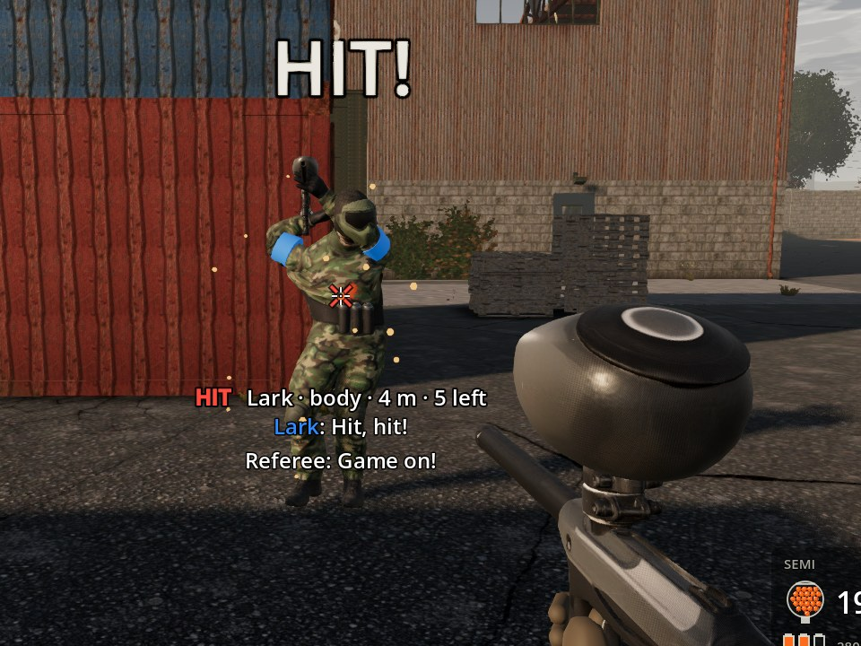
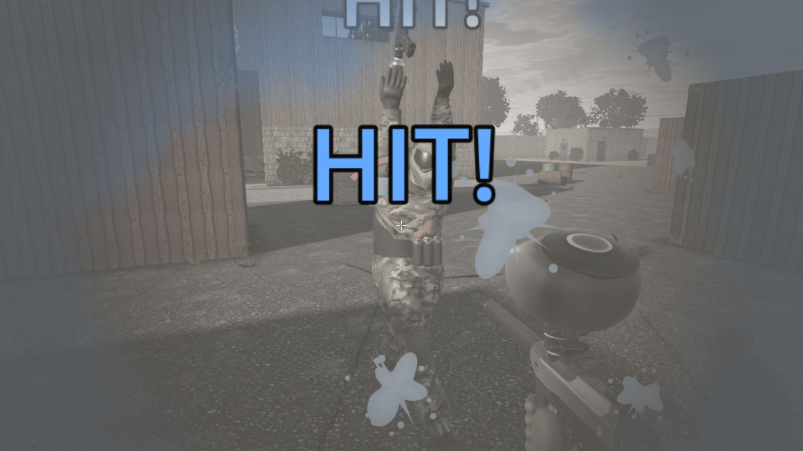
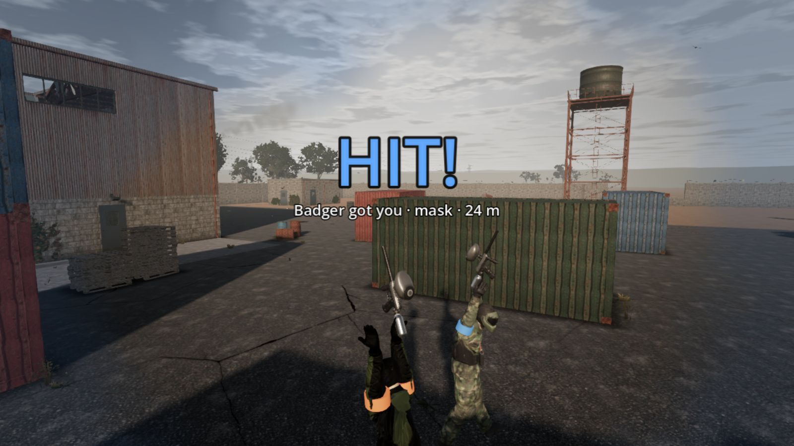
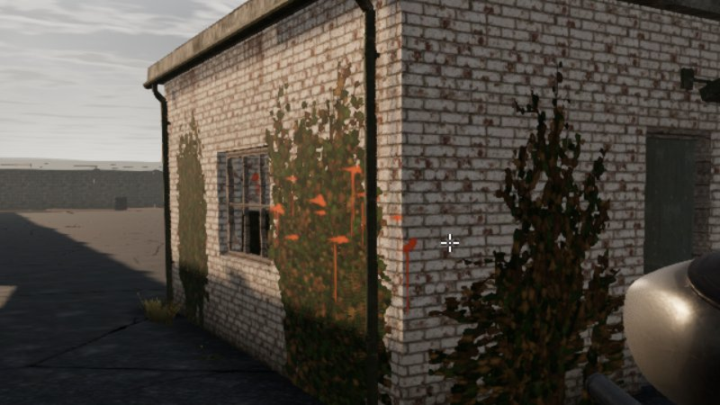
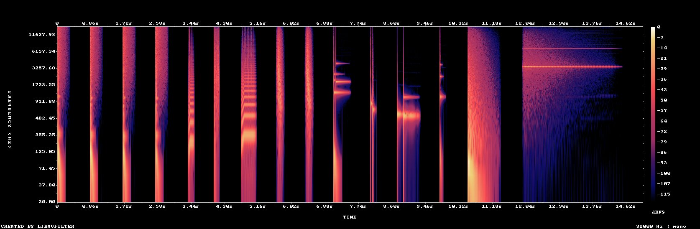
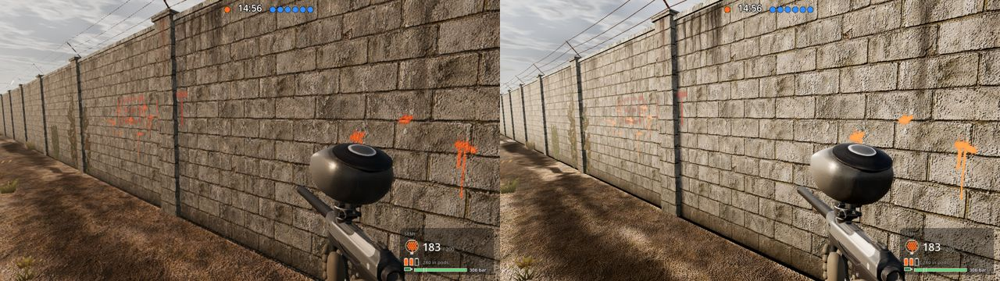
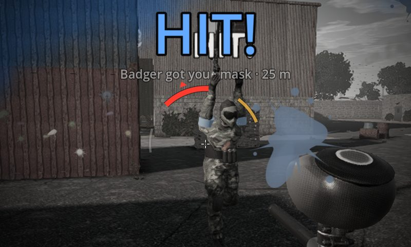

# Phase 5 report

**Plan:** [phase-5.md](../phase-5.md) · **Design:** [architecture §18](../architecture.md#18-phase-5-feel-characters-modes-a-big-site-and-a-build-to-share)

Each item of the phase is its own pull request, stacked in Tim's order: A (feel and hit feedback), B (characters), C1
(capture the flag and VIP escort), C2 (the woodsball site with buggies) and D (a build to share). Each adds its part
here when it lands.

## M5.1 (A) — Feel and hit feedback

**Branch:** `claude/eager-cannon-c05kkv`

### What was built

- **The marker sounds like one.** The report is rebuilt in the order a marker's parts sound: the sear's click, the
  valve's gas cracking out of the muzzle, its thump through the marker (a low note falling away), the barrel ringing as a
  tube, the ball's "fwip" as it leaves, and the bolt knocking back home a moment later. As the tank empties the gas's part
  fades faster than the pressure, so a low tank sounds thin and mechanical. The loader now drops two balls into the
  breech after each shot, rattles as you run, jump and land (loudest half full; a full one is packed, an empty one
  silent), and its motor spins on nothing when you fire it empty.
- **Balls whizz past.** Any ball (not yours) passing within 1.6 m of your head whizzes past from where it passed:
  louder the closer, its pitch falling as it goes.
- **Hit markers that say what happened.** An X pops up round the crosshair and settles: red with a white flash and a
  confirm sound when your ball puts someone out, with a line under the crosshair (HIT · who · where · how far · how many
  are left); thin and grey with a dull "tok" when it bounced off them (it doesn't count); amber, ringed, when it was a
  teammate.
- **Where paint is coming from.** Arcs on a ring round the crosshair point back along each ball's own flight: pale for
  one whizzing past your head, amber for one breaking near you, orange for one bouncing off you, red with a chevron for
  the one that got you. Paint from much the same way refreshes one arc. They show where you're being shot from, never
  where anyone is.
- **The moment you're hit.** You hear the thud and your ears ring while everything else goes muffled and opens up
  again over two seconds; the screen flashes, drains of colour and floods with the paint's colour from the side it came
  from; **HIT!** pops up with who got you, where and from how far. The view holds in your eyes for a moment, then the
  camera rises out of your head and eases back to watch you, hand and marker up; then you walk off the field (offline
  too, now, as the bots and hosted players did already), the camera following you with whoever got you in view.
- **Splats shaped by the hit.** Round head-on; at a glance, stretched along the ball's travel (up to 3.2 times as long
  as wide), and past 1.45 a streak: a head, a tail and spatter thrown on ahead. On bodies they stretch less. And paint
  on your own marker: a ball that puts you out by your marker, loader or tank leaves a splat on it, and one breaking on
  cover close in front of you spatters it with drops; the paint runs down as it dries, for the round.
- **Settings** (Gameplay): incoming-fire arcs on or off; how strongly being hit takes over the screen.
- **Data**: everything in `presentation.jsonc` → `feedback` (near misses, arcs, markers, the hit moment, paint on your
  marker), `splat.stretchMax`/`streakFrom`, and eight new `audio.mix` levels.

### How it looks and sounds

The duel demo, rendered under the software renderer (`-- --duel-demo --duel-distance=4`):

| | |
|---|---|
|  |  |
|  |  |

[a-sounds.ogg](phase-5/a-sounds.ogg) has the new sounds in a row, half a second apart: the report at full pressure
(twice), half and low; the loader feeding, rattling and spinning empty; two whizzes; the confirm, the bounce that didn't
count and the teammate; a ball bouncing off you; being hit, and the ringing after. Every sound can be written out as WAV
files with `godot --headless --path game res://tools/ArtImport.tscn -- --sounds=/tmp/sounds`.



### How to run it

```bash
dotnet test tests/Pb.Sim.Tests --filter "FullyQualifiedName~FeedbackTests|FullyQualifiedName~SoundTests"   # the sums and the sounds' shapes
godot --path game res://scenes/Level.tscn -- --duel-demo --duel-distance=4    # the hit marker, then the hit moment and the walk-off
godot --path game res://scenes/Level.tscn -- --splat-demo                     # streaks at a glance, round splats square on
godot --headless --path game res://scenes/Level.tscn -- --bot-match --mode=teams --size=5 --min-feedback=1   # prints the feedback line
```

Or just play: every round has it.

### Checks

| Check | Result |
|---|---|
| `dotnet test tests/Pb.Sim.Tests` | 479 passed (21 new) |
| `dotnet test tests/Pb.Net.Tests` | 69 passed |
| `tools/ci/smoke-test.sh` | 32 of 32 passed, no leaks at exit |

New tests:
- `FeedbackTests`: which way an arc points for paint from each side, that it turns with you, merging and refreshing
  (and never downgrading), each kind's life and fade, a full ring dropping its oldest, paint falling straight down
  giving none, a bounce mirrored back; a ball passing close found once on the tick it passes, your own, slow and wide
  balls not, a ball still closing in not yet, and a real shot past someone's head found once at the right distance.
- `SoundTests`: every sound renders and none is silent; the report at its loudest within 12 ms, 80 % of it in 60 ms,
  more of it below 200 Hz at full pressure than low; the whizz peaking mid-way and higher coming than going; the confirm
  bright and the bounce dull; the ears still ringing at 1.5 s; the rattle short, and the hit you take heavier than a
  ball breaking on someone else.
- `SettingsTests`: the two new settings' defaults and clamping.
- The bot match prints a feedback line and fails if you were put out by a ball and the hit moment didn't play;
  CI's art-on 5 v 5 also needs at least one arc or marker (`--min-feedback=1`).

Every one of the smoke suite's 20 bot matches printed its feedback line, and in the 14 where your bot was put out by
a ball the hit moment played each time. The art-on 5 v 5:

```
BOT MATCH feedback: hit markers 2 out, 0 bounced, 0 teammates; incoming-fire arcs 24 whizzes, 8 near breaks, 2 bounces off you, 0 hits; 24 balls whizzed past (24 heard); 2 confirms; 11 streaked splats; 1 on your marker; hit moment played 0 times
```

Quitting now frees the scene and lets .NET finalise what it holds before Godot counts what's left
(`game/core/CleanExit.cs`): the exit leak reports that came and went on the Flanker and teams runs are gone.

### Known issues

- **Judged by measurement, not by ear.** The sounds were designed from how markers work and checked by their shapes
  (the tests and the spectrogram above); only your ears can say whether they're satisfying. Every level is in
  `presentation.jsonc` → `audio` → `mix`, and the recipes are in `game/audio/SoundBank.cs`.
- **Paint on your marker sits at set spots.** It lands on eight spots on the marker (data), not where the ball would
  have hit the model; on the generated marker the spots were placed by eye.
- **Arcs from a bounce point back along the bounce's way in, worked out from its way out**, which is close but not exact
  for a ball that spun off a corner.
- **Joined players' walk-off** is the host's to start, as before; the camera and the moment play the same.

### After Tim's check of the stack

Tim played the stack (#11 to #18) and found four things wrong on this branch's side; each is fixed here and merged up
the stack.

- **No splats on walls.** Two causes:
  - Godot's Compatibility renderer, which it falls back to (OpenGL) on a graphics card or driver without Vulkan, draws no
    decals at all, so every splat and run of paint was invisible there. Where the renderer draws no decals, splats and
    runs are now flat cards on the surface (`game/ballistics/PaintCards.cs`), in the decal's frame and size.
  - The splat demo aimed its square-on shots past the end of the wall it found, printed no result, and its last frame
    of a capture was empty (the scene freed before the quit). Now it picks the nearest wall with a clear stretch long
    enough for both runs, keeps its view to the end, and checks: the shots broke on the wall, the glancing ones
    streaked, a splat was placed for each, and drawn, the screen at each break looks painted against the same view
    before the first shot. CI runs it headless (`splat`). Under Vulkan and under Compatibility, 12 of the 14 breaks in
    view look painted (the other two are at a grazing angle far along the wall).
- **The incoming-paint arcs** were drawn under the paint on your mask and the moment you're hit (the HUD is layer 1,
  those 5 and 6), so the arc pointing back at the ball that got you was all but hidden. The arcs now have their own
  layer (7), and HIT! sits higher (`hitMoment.textAt`), clear of their ring. The duel demo now also sends a ball past
  your head and one breaking close by, and looks at the screen where the HUD says each arc is: all three are on it
  (with the arcs back under the overlays, the check fails on the Hit arc). CI runs it headless (`duel`).
- **`ObjectivePacingTests` failed on another machine** (hold, Hospital Wing, seed 4). Its rounds are chaotic, and a
  machine whose floating point differs a hair plays them differently; the fix is for every round to end, not just the
  six pinned. A sweep of 32 seeds of that round had 7 still running out the clock, and two causes:
  - a bot in the pocket between a door standing open and the wall it opened toward stepped straight off the leaf, into
    the wall, and planned through the leaf again for the rest of the round: it now steps round the leaf's free end
    (`DoorTests.A_bot_tucked_behind_a_leaf_standing_open_walks_round_its_end`, which fails with the old step);
  - a bot started on top of a boiler in the boiler house had no way down, and held the room contested: cover on a piece
    of the bots' grid apart from the one most cover stands on is stranded (`CoverPoint.Stranded`), and nobody starts
    there (`SpawnVarietyTests.Nobody_starts_somewhere_with_no_way_off`; 37 such points on the Hospital Wing, 42 on the
    Rail Yard, 8 in the Cold Store).

  Afterwards all 32 seeds of that round ended, and so did 16 seeds each of the other five pinned rounds (112 rounds,
  none to the clock).
- **Captures had no sound**: Movie Maker runs Godot's dummy audio driver, and the game started no sounds under it. It
  now does when writing a movie, which mixes them into the capture's `f.wav`.

| The splat demo's last frame: Vulkan's decals, and the cards under Compatibility (OpenGL) | The three arcs: past your head (pale, left), breaking close by (amber, right) and the one that put you out (red), over the paint on your mask |
|---|---|
|  |  |

### What's next

PR B, the characters' animation set.
