# Phase 5 report

**Plan:** [phase-5.md](../phase-5.md) · **Design:** [architecture §18](../architecture.md#18-phase-5-feel-characters-modes-a-big-site-and-a-build-to-share)

Each item of the phase is its own pull request, stacked in Tim's order: A (feel and hit feedback), B (characters), C1
(capture the flag and VIP escort), C2 (the woodsball site with buggies) and D (a build to share). Each adds its part
here when it lands.

## M5.1 (A) — Feel and hit feedback

**Branch:** `claude/eager-cannon-c05kkv`

### What was built

- **The marker sounds like one.** The report is rebuilt in the order a marker's parts sound: the sear's click, the
  valve's gas cracking out of the muzzle, its thump through the marker (a low note falling away), the barrel ringing as a
  tube, the ball's "fwip" as it leaves, and the bolt knocking back home a moment later. As the tank empties the gas's part
  fades faster than the pressure, so a low tank sounds thin and mechanical. The loader now drops two balls into the
  breech after each shot, rattles as you run, jump and land (loudest half full; a full one is packed, an empty one
  silent), and its motor spins on nothing when you fire it empty.
- **Balls whizz past.** Any ball (not yours) passing within 1.6 m of your head whizzes past from where it passed:
  louder the closer, its pitch falling as it goes.
- **Hit markers that say what happened.** An X pops up round the crosshair and settles: red with a white flash and a
  confirm sound when your ball puts someone out, with a line under the crosshair (HIT · who · where · how far · how many
  are left); thin and grey with a dull "tok" when it bounced off them (it doesn't count); amber, ringed, when it was a
  teammate.
- **Where paint is coming from.** Arcs on a ring round the crosshair point back along each ball's own flight: pale for
  one whizzing past your head, amber for one breaking near you, orange for one bouncing off you, red with a chevron for
  the one that got you. Paint from much the same way refreshes one arc. They show where you're being shot from, never
  where anyone is.
- **The moment you're hit.** You hear the thud and your ears ring while everything else goes muffled and opens up
  again over two seconds; the screen flashes, drains of colour and floods with the paint's colour from the side it came
  from; **HIT!** pops up with who got you, where and from how far. The view holds in your eyes for a moment, then the
  camera rises out of your head and eases back to watch you, hand and marker up; then you walk off the field (offline
  too, now, as the bots and hosted players did already), the camera following you with whoever got you in view.
- **Splats shaped by the hit.** Round head-on; at a glance, stretched along the ball's travel (up to 3.2 times as long
  as wide), and past 1.45 a streak: a head, a tail and spatter thrown on ahead. On bodies they stretch less. And paint
  on your own marker: a ball that puts you out by your marker, loader or tank leaves a splat on it, and one breaking on
  cover close in front of you spatters it with drops; the paint runs down as it dries, for the round.
- **Settings** (Gameplay): incoming-fire arcs on or off; how strongly being hit takes over the screen.
- **Data**: everything in `presentation.jsonc` → `feedback` (near misses, arcs, markers, the hit moment, paint on your
  marker), `splat.stretchMax`/`streakFrom`, and eight new `audio.mix` levels.

### How it looks and sounds

The duel demo, rendered under the software renderer (`-- --duel-demo --duel-distance=4`):

| | |
|---|---|
| 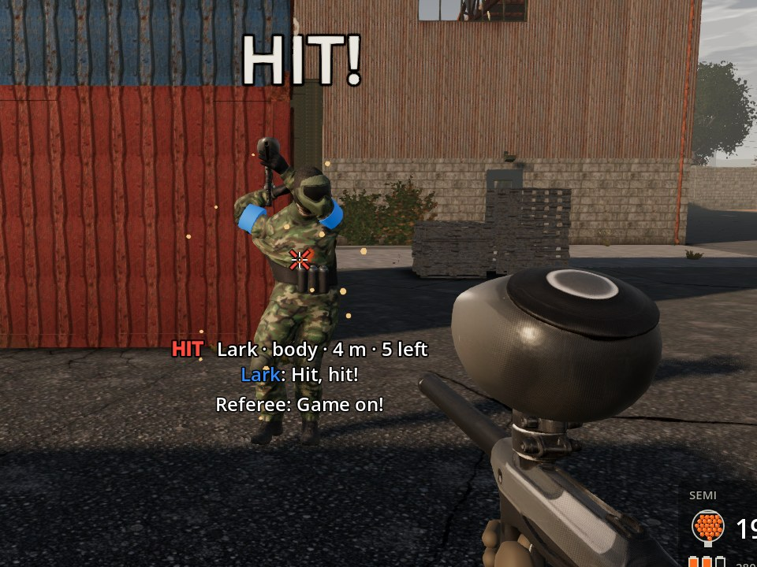 | 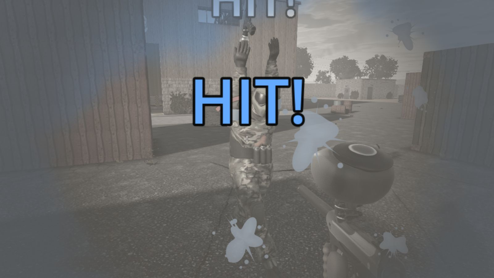 |
| 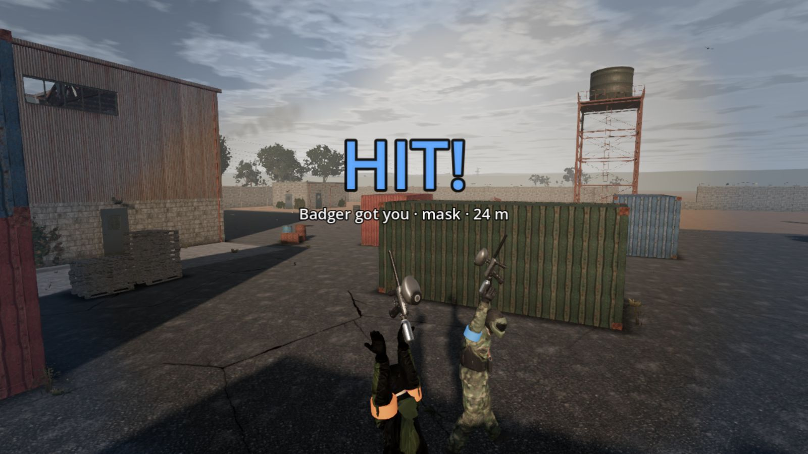 | 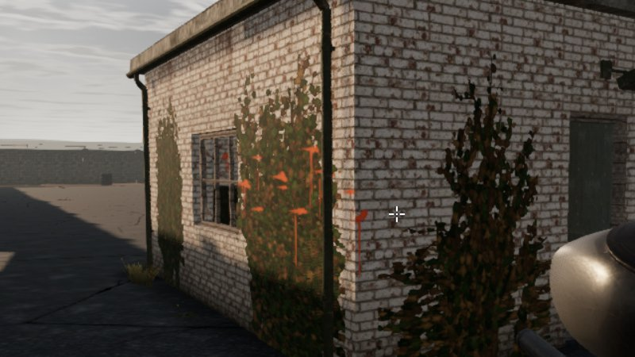 |

[a-sounds.ogg](phase-5/a-sounds.ogg) has the new sounds in a row, half a second apart: the report at full pressure
(twice), half and low; the loader feeding, rattling and spinning empty; two whizzes; the confirm, the bounce that didn't
count and the teammate; a ball bouncing off you; being hit, and the ringing after. Every sound can be written out as WAV
files with `godot --headless --path game res://tools/ArtImport.tscn -- --sounds=/tmp/sounds`.

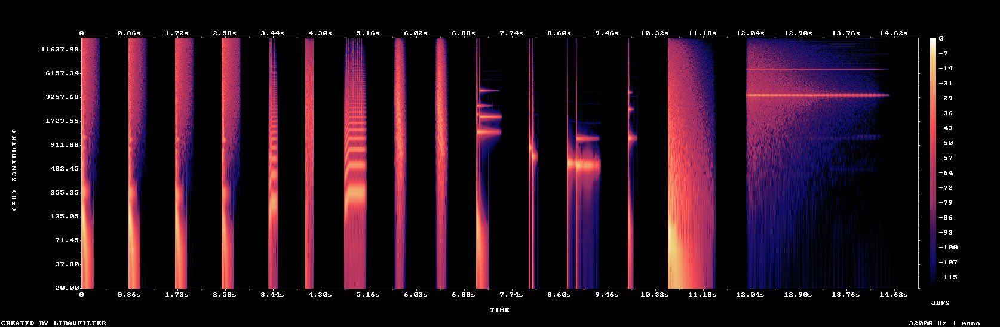

### How to run it

```bash
dotnet test tests/Pb.Sim.Tests --filter "FullyQualifiedName~FeedbackTests|FullyQualifiedName~SoundTests"   # the sums and the sounds' shapes
godot --path game res://scenes/Level.tscn -- --duel-demo --duel-distance=4    # the hit marker, then the hit moment and the walk-off
godot --path game res://scenes/Level.tscn -- --splat-demo                     # streaks at a glance, round splats square on
godot --headless --path game res://scenes/Level.tscn -- --bot-match --mode=teams --size=5 --min-feedback=1   # prints the feedback line
```

Or just play: every round has it.

### Checks

| Check | Result |
|---|---|
| `dotnet test tests/Pb.Sim.Tests` | 479 passed (21 new) |
| `dotnet test tests/Pb.Net.Tests` | 69 passed |
| `tools/ci/smoke-test.sh` | 32 of 32 passed, no leaks at exit |

New tests:
- `FeedbackTests`: which way an arc points for paint from each side, that it turns with you, merging and refreshing
  (and never downgrading), each kind's life and fade, a full ring dropping its oldest, paint falling straight down
  giving none, a bounce mirrored back; a ball passing close found once on the tick it passes, your own, slow and wide
  balls not, a ball still closing in not yet, and a real shot past someone's head found once at the right distance.
- `SoundTests`: every sound renders and none is silent; the report at its loudest within 12 ms, 80 % of it in 60 ms,
  more of it below 200 Hz at full pressure than low; the whizz peaking mid-way and higher coming than going; the confirm
  bright and the bounce dull; the ears still ringing at 1.5 s; the rattle short, and the hit you take heavier than a
  ball breaking on someone else.
- `SettingsTests`: the two new settings' defaults and clamping.
- The bot match prints a feedback line and fails if you were put out by a ball and the hit moment didn't play;
  CI's art-on 5 v 5 also needs at least one arc or marker (`--min-feedback=1`).

Every one of the smoke suite's 20 bot matches printed its feedback line, and in the 14 where your bot was put out by
a ball the hit moment played each time. The art-on 5 v 5:

```
BOT MATCH feedback: hit markers 2 out, 0 bounced, 0 teammates; incoming-fire arcs 24 whizzes, 8 near breaks, 2 bounces off you, 0 hits; 24 balls whizzed past (24 heard); 2 confirms; 11 streaked splats; 1 on your marker; hit moment played 0 times
```

Quitting now frees the scene and lets .NET finalise what it holds before Godot counts what's left
(`game/core/CleanExit.cs`): the exit leak reports that came and went on the Flanker and teams runs are gone.

### Known issues

- **Judged by measurement, not by ear.** The sounds were designed from how markers work and checked by their shapes
  (the tests and the spectrogram above); only your ears can say whether they're satisfying. Every level is in
  `presentation.jsonc` → `audio` → `mix`, and the recipes are in `game/audio/SoundBank.cs`.
- **Paint on your marker sits at set spots.** It lands on eight spots on the marker (data), not where the ball would
  have hit the model; on the generated marker the spots were placed by eye.
- **Arcs from a bounce point back along the bounce's way in, worked out from its way out**, which is close but not exact
  for a ball that spun off a corner.
- **Joined players' walk-off** is the host's to start, as before; the camera and the moment play the same.

### What's next

PR B, the characters' animation set.

## M5.2 (B) — The characters' animation

**Branch:** `claude/eager-cannon-c05kkv-animation` (on A's)

### What was built

- **An animation set made by script.** `tools/anim/build_clips.py` keyframes it in Blender 4.2 (no window needed) on
  the generator's biped rig. It has 24 clips:
  - idle and crouched idle;
  - walk, jog, run and crouched walk, each forward, right, back and left;
  - sprint;
  - the lean's brace each way;
  - the refill, a flinch, and hands up.

  Steps work the way feet do: the ball of the foot is planted and moves back under the body at exactly the clip's
  speed, the heel peels up over it, and the swing lands at ground speed, so the foot touches down still. Every step
  cycle starts with the left foot landing, so any of them can blend in step. The clips' speeds are the game's own data
  (`characters.animPaces`), so each speed the sim moves at has a clip made for it.
- **Blended every frame from how they move** (`ClipBlender`).
  - Speed picks the pace. Direction picks the clips round it: forward, sideways, backing off, and anything between.
  - All the clips share one step phase, which moves on by the ground covered, so planted feet keep pace at any speed.
  - Crouching, sprinting, the lean, the refill (in step with the sim's), the flinch, and hands up when out are layered
    on top.
  - Every weight eases in and out at a capped rate. A stop from a sprint eases down through the run and the walk to the
    idle in about a third of a second, and it looks the same at 15, 30 or 120 fps.
- **Feet that stay where they land.**
  - Each foot that's down in the clips is held where it came down, while the clip rolls the heel up over the ball. So
    when the body turns while running, or between two clips' strides, the feet don't skate.
  - When the foot lifts, it eases back onto its clip's path for the next landing.
  - Standing still and turning on the spot, the feet step round, one at a time, lifted. After a stop, the feet settle
    into the stance with a step.
- **Fitted to each character's build.** The set is baked onto each of the three models when they load, using their own
  proportions, with the feet on their clips' paths scaled to the legs. Feet still go onto stairs and kerbs by the ground
  under each one, as before.
- **The old steps stay as the fallback** (`"legs": "steps"`) if the set is missing.

### Before and after

The gait demo (`-- --gait-demo`), rendered under the software renderer. In each pair, the top row is before (the planted
steps) and the bottom row is after (the animation set), filmed from the side: six moments a tenth of a second apart (a
fifteenth running and sprinting; turning, about a quarter).

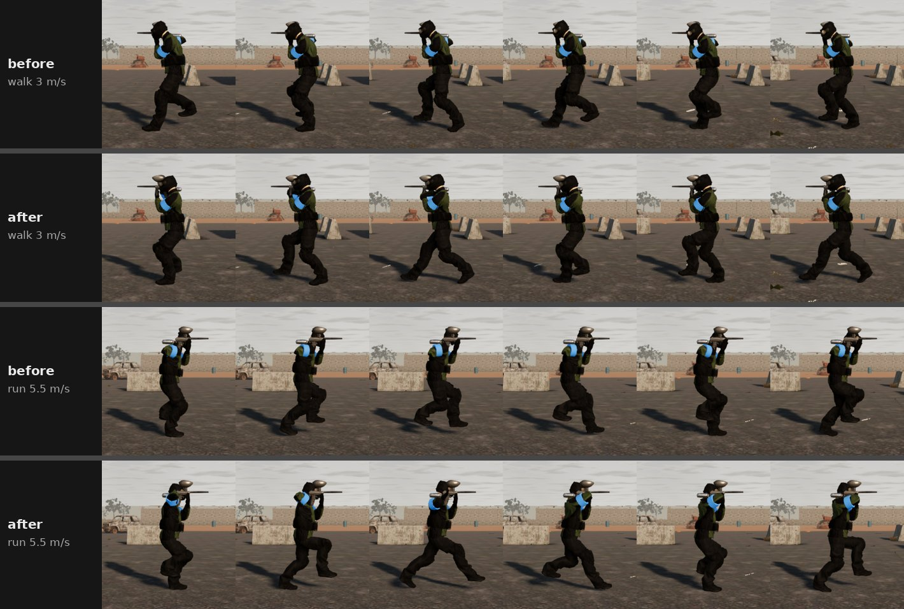

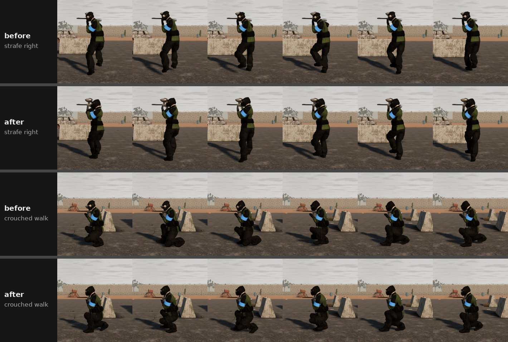

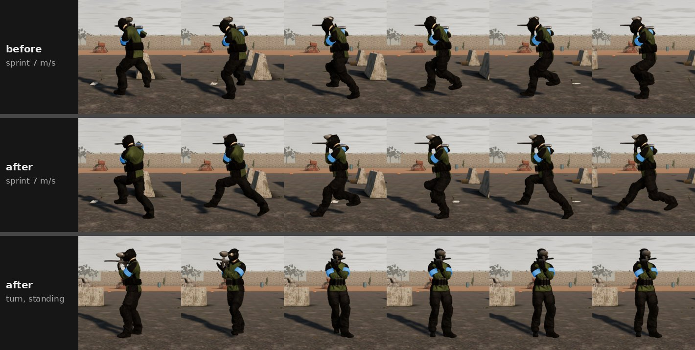

The gait check's numbers, before (the planted steps, on A) and after. Slide is how fast a foot that's down moves
across the ground. Jerk is the most the head, hands or hips change their frame-to-frame step against the body, which
is what a pop looks like:

| Move | Feet slide, 120 fps | Jerk, 30 fps | Jerk, 15 fps |
|---|---|---|---|
| walk | 0.12 → 0.03 m/s | 1.7 → 0.7 cm | 4.2 → 2.5 cm |
| run (turning round as it starts) | 0.15 → 0.15 m/s | 1.4 → 1.1 cm | 4.8 → 3.8 cm |
| sprint (turning round as it starts) | 0.17 → 0.03 m/s | 2.0 → 1.5 cm | 6.5 → 4.3 cm |
| stop | 0.00 → 0.00 m/s | 0.1 → 0.1 cm | 3.5 → 3.4 cm |
| strafe right | 0.11 → 0.02 m/s | 1.0 → 0.9 cm | 5.3 → 3.2 cm |
| strafe left | 0.11 → 0.05 m/s | 1.9 → 0.8 cm | 8.3 → 2.9 cm |
| back off | 0.13 → 0.09 m/s | 1.6 → 0.8 cm | 4.2 → 2.9 cm |
| crouched walk | 0.09 → 0.03 m/s | 0.4 → 0.6 cm | 1.6 → 2.1 cm |
| turn left, on the spot (new) | 0.00 m/s | 0.1 cm | 0.2 cm |
| turn right, on the spot (new) | 0.00 m/s | 0.1 cm | 0.2 cm |

The run's remaining slide comes from the turn it starts with: running round a tight turn at 240° a second, a held foot
the leg can no longer reach gives way just far enough to pivot.

### How to run it

```bash
godot --path game res://scenes/Level.tscn -- --gait-demo                     # one opponent through every move, from the side
godot --path game res://scenes/Level.tscn -- --gait-demo --gait-only=turn    # just turning on the spot
godot --headless --path game --fixed-fps 30 res://scenes/Level.tscn -- --gait-demo --gait-check   # the numbers, as CI checks them
blender -b --factory-startup -P tools/anim/build_clips.py -- game/art/models/clip_walk.glb game/art/models/anim_set.glb
godot --headless --path game --import                                         # after remaking the set
```

Or play: every character uses the set.

### Checks

| Check | Result |
|---|---|
| `dotnet test tests/Pb.Sim.Tests` | 482 passed (3 new) |
| `dotnet test tests/Pb.Net.Tests` | 69 passed |
| `tools/ci/smoke-test.sh` | 32 of 32 passed (the gait check now 12 moves at each rate) |

New tests and checks:
- `AnimationDataTests`: every speed the sim moves at has a clip made for it; the set holds every clip the blender plays,
  each starting at 0 s; each step cycle is as long as its cadence makes it. Two faults turned up while building this.
  Blender's export keyed every clip from frame 1, so Godot held the first pose for a frame, a stall in every stride; the
  last two tests guard against that. And the feet were placed from under the swaying hips, so a planted foot swayed
  with them; the gait check's slide would show that.
- The gait demo has two new moves, turning on the spot each way. Its line for each move now says how far the feet were
  held off their clips' paths and how many steps they took standing. CI runs the gait check at 120, 30 and 15 fps, and
  the art-on bot match's pop check, as before. The worst pop in the art match was 2.7 cm at 120 fps, against a 15 cm
  limit.

### Known issues

- **Made by script, not motion capture.** The gaits are believable but plain, and all three characters share them
  (only the idle's timing differs). The clips are easy to tune: the gait table and the poses are at the top of the script.
- **No clips for jumping, landing, sliding or climbing.** In the air or sliding, the step cycle holds where it is.
  Ladders still place the limbs themselves, as before.
- **Leaning only braces the legs.** The upper body's roll is still the sim's lean, as before.
- **Sharp turns while running pivot the held foot** (up to 13 cm off its path) rather than taking an extra step.

### What's next

PR C1: capture the flag and VIP escort.

## M5.3 (C1) — Capture the flag and VIP escort

**Branch:** `claude/eager-cannon-c05kkv-modes` (on B's)

### What was built

Two new objectives, played by two teams in any area (the menu and the lobby offer them in teams only):

- **Capture the flag.**
  - Each side's flag stands at its base: where that side starts, marked by a ring in its colour.
  - Walk onto theirs to take it, then carry it home to your base. You can't sprint while carrying it.
  - Hit while carrying it, you drop it where you fell. Your own side touching your fallen flag sends it home, and left
    alone it goes home by itself after 30 s. Either side can pick a fallen flag up again.
  - The round is won by a capture, or by the last side standing. When time runs out, nobody wins.
- **VIP escort.**
  - One of your side is the VIP: unarmed, at 80 % of everyone's pace, never sprinting. Offline it's always one of your
    bot teammates, so you're the escort.
  - Bring the VIP to one of the far ways out to win.
  - If the VIP is hit, or the time runs out, the other side wins.
- **Bots that play them.**
  - *Capture the flag.* Each side posts a few guards beside its base and sends the rest for the other flag. Attackers
    carry it home or cover whoever has it. The nearest bot sends its own fallen flag home, and a side whose flag is
    taken goes after the carrier. When a side's attackers are all out, guards take their place.
  - *VIP escort.* The escorts lead the VIP a few steps ahead toward the way out. The VIP waits for them and takes cover
    when it's shot at. The defenders guard the ways out that count from the start, and hunt the VIP once they hear
    where it is.
  - *Every mode.* Bots shoot a VIP or a carrier first. A bot blocked by someone standing in its path now steps round
    them. Before, an attacker walking into its own guard stood there until it gave up.
- **On screen.**
  - Flags on poles in their side's colour: standing at the base, on the carrier's back, or lying where they fell.
  - A marker over the VIP's head and beams over the ways out.
  - The HUD line and markers: their flag, your base while you carry it, your own flag (in red) whenever it's away, and
    the VIP or their way out.
  - Toasts, the objective's sounds, outcome screens, the referee, the bases and the VIP on the briefing map, callouts
    ("Cut them off!"), and `--objective-demo` for both.
- **Online.** Every copy works out the same bases and VIP from the roster and the seed. The flags and the VIP's fate
  travel in the snapshot (protocol 4).

### How it looks

| 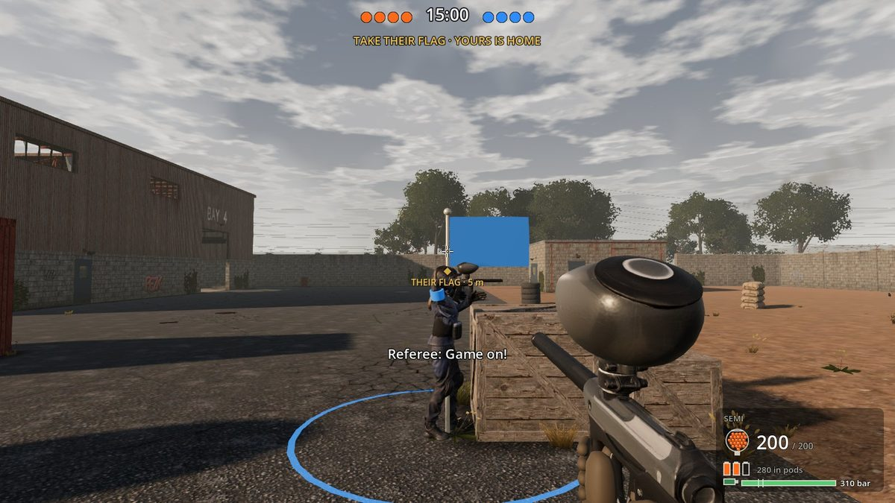 | 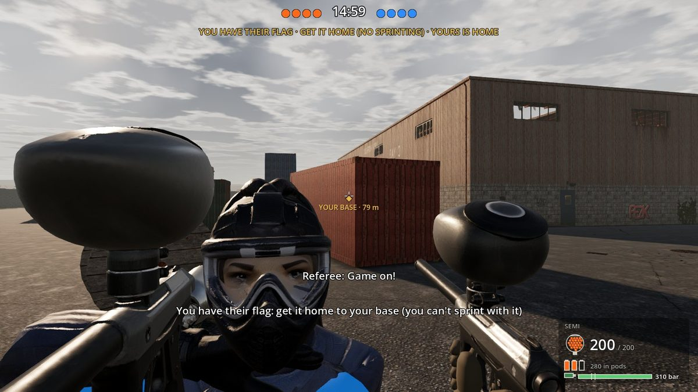 |
|---|---|

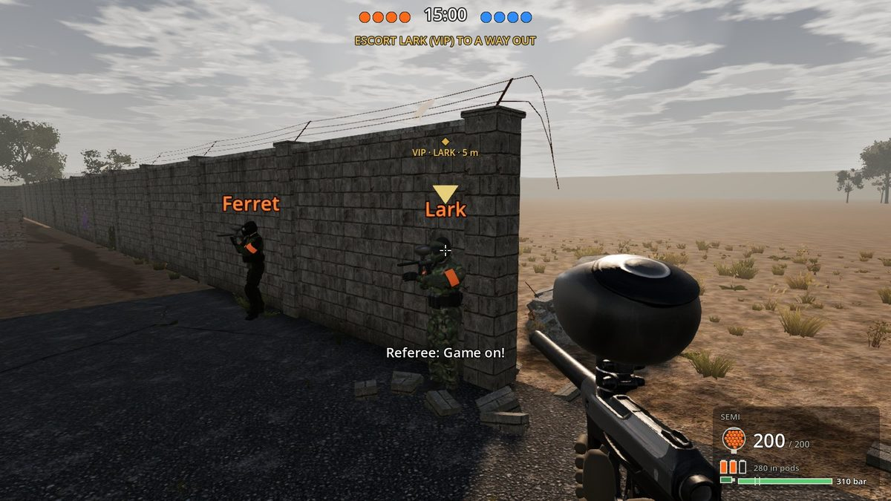

Captured with `--objective-demo` under lavapipe at the low preset.

### How to run it

```bash
godot --path game res://scenes/Level.tscn -- --mode=teams --size=4 --objective=flag      # or --objective=escort
godot --path game res://scenes/Level.tscn -- --objective-demo --objective=flag --mode=teams
godot --headless --path game res://scenes/Level.tscn -- --bot-match --mode=teams --size=4 --objective=escort --no-art
```

Or pick Teams in the menu: capture the flag and VIP escort are in its objectives.

### Checks

| Check | Result |
|---|---|
| `dotnet test tests/Pb.Sim.Tests` | 494 passed (12 new) |
| `dotnet test tests/Pb.Net.Tests` | 70 passed (1 new) |
| `tools/ci/smoke-test.sh` | 36 of 36 passed (4 new) |

New tests and runs:
- `FlagEscortTests`:
  - capture the flag: where the bases are; taking, carrying and capturing a flag; dropping it, both ways it goes home,
    and the other side picking it up again; nobody wins on time;
  - VIP escort: the VIP is dealt from the seed (a bot, the same every time, a person only on a side of people); can't
    fire and doesn't sprint; only the far ways out count; the round ends three ways (out, hit, time).
- `FlagEscortBotTests`: bots take and capture a flag; a side whose flag is taken is told where the carrier is; the
  defenders guard the VIP's ways out from the start; bots bring the VIP out.
- `NetRoundTests`: a capture the flag round stands the same on every copy, with the bases worked out locally and the
  carried and fallen flag where the server has it.
- Smoke: 4 v 4 rounds of both on Oxbarrow Works, capture the flag on the Rail Yard, VIP escort in the Hospital Wing.
  In the final run, capture the flag on Oxbarrow Works ended after 29 s with your side out and your flag being carried
  off. On the Rail Yard your side cleared theirs after 44 s, with both flags home. The VIP got out of Oxbarrow Works
  after 21 s and was put out in the Hospital Wing after 22 s.

How the bots' rounds went, 4 v 4 on Oxbarrow Works across seeds while tuning:
- Capture the flag: rounds of 30–55 s. Most end with one side out; some end in a capture (one in 33 s, the defence
  beaten to it).
- VIP escort: rounds of 15–36 s. The VIP got out in 2 of 6, which matches how VIP games usually favour the defence.
  Before the defenders guarded the ways out, the VIP walked out every time in 20 s; before the VIP took cover, it was
  hit every time.

### Known issues

- **One capture wins the round.** There's no score to a set number of captures yet; a round is a round, like the
  others.
- **The alarms borrow recorded lines** ("Cut them off!", "There!") rather than having their own ("They've got our
  flag!"), until a voice take for them is made.
- **Escort balance is tuned on Oxbarrow Works.** Escort rounds on the other areas pass the smoke runs, but how often
  the VIP gets out there hasn't been measured.
- **The VIP is always a bot when your side has one.** You can't choose to be the VIP offline.

### What's next

PR C2: the big woodsball site, with buggies.

## M5.4 (C2) — Thornwick Woods, with buggies

**Branch:** `claude/eager-cannon-c05kkv-woodsball` (on C1's)

### What was built

Tim found the areas too small, so the new map is a big open site to roam, with vehicles to cross it in:

- **Thornwick Woods.**
  - *Size.* A woodsball site on old farmland, 344 × 244 m inside its timber fence: seven times Oxbarrow Works.
  - *What's on it.* Four woods and a copse (548 trees), hedged fields with 175 pieces of cover over them, a timber fort
    with a lookout tower, a farm, a camp of containers and huts, a scrapyard, and gravel tracks that cross in the
    middle and run round inside the fence.
  - *Getting in.* A gate in each side to come in at, and six places to play: the whole site, the farm, the north field
    and the fort, Blackthorn Wood, the camp and the scrapyard.
  - *Source.* It's generated by `tools/levels/thornwick_woods.py` from a few dozen lines of layout. The woods and the
    scattered cover are dealt from fixed seeds, kept off the tracks, hedges, buildings and starts.
- **Buggies** (five: two at the south gate, one each at the camp, the scrapyard and the north field).
  - *Getting in and driving.* Get in at a door with F, as the driver or the passenger. W and S are the pedal (brake,
    then reverse) and A and D steer; the view turns with the buggy. Get out with F once it's nearly stopped, beside
    your seat or wherever there's room.
  - *Handling.* It's a bicycle model with a top speed of 43 km/h (the site's limit), and it stops at walls, trees,
    cover and other buggies.
  - *The field's rules* (in `vehicles.jsonc`, decided by the sim). The driver keeps both hands on the wheel and can't
    fire; the passenger can. Paint breaks on the buggy and never counts. Someone hit in it gets out and walks off, and
    without a driver it rolls to a stop. A buggy never hits anyone: it brakes to stop short of them, whatever the
    driver does.
  - *On screen.* A buggy built in code, with a tub, roll cage, seats and steering wheel, and wheels that roll and steer.
    Splats stay on it as it drives off. It has a two-stroke engine sound that rises with speed. The HUD shows its speed
    and when you can get out.
- **Bots drive.** A bot going a long way, such as their flag, a case or a room across the site, takes a buggy standing
  empty nearby if that's quicker. It drives the tracks, keeping to them round corners, and gets out near where it's
  going. Seeing an enemy close, it stops and gets out to fight. Blocked, it backs up and tries again, then gives up and
  walks.
- **Online.** Buggies travel in the snapshot and their comings and goings as events (protocol 5). A joined driver rides
  where their copy draws the buggy.
- **Size, kept affordable.**
  - *Grid build.* The bots' grid builds in bands on several threads, and this level's grid is a little coarser
    (0.35 m). The grid of 806,000 places builds in about 3 s (6.6 s at first).
  - *Searches.* Long searches across the site take 1–12 ms, spread over ticks as before.
  - *Drawing.* The woods are drawn in 40 m squares that hide past 170 m (trunks) and 330 m (leaves). There are no weed
    tufts on the open fields.
  - *Balls.* A buggy's paint box is tested against every ball in the level, so a sphere round it turns away the balls
    passing nowhere near it first. A tick with 1,000 balls costs 0.25 ms here, against 0.4 ms without that check.
- **The menu.** The area buttons are narrower, and an area with six places has a shorter picture, so every area's card
  still fits a 1600 × 900 screen with a fifth area in the list.

### How it looks

| 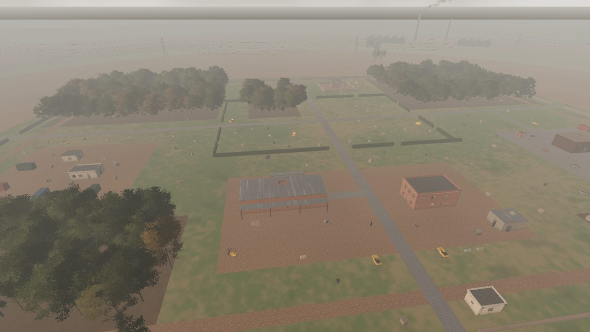 | 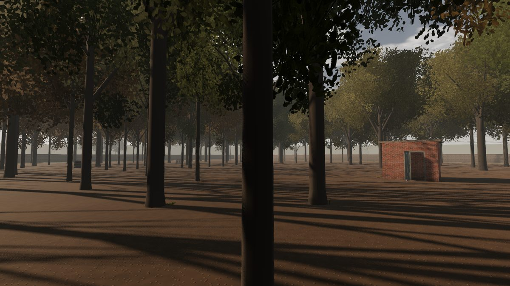 |
|---|---|
| 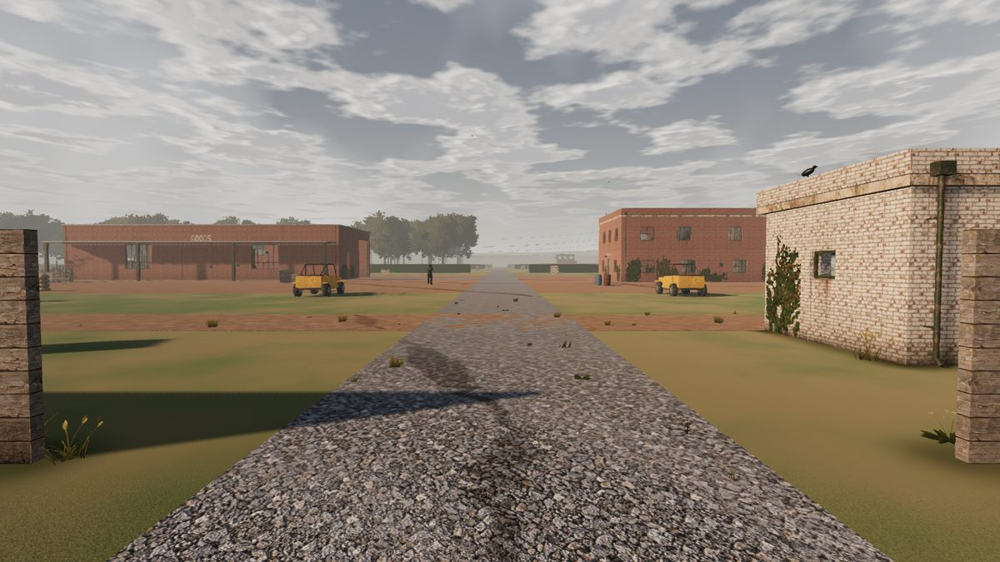 | 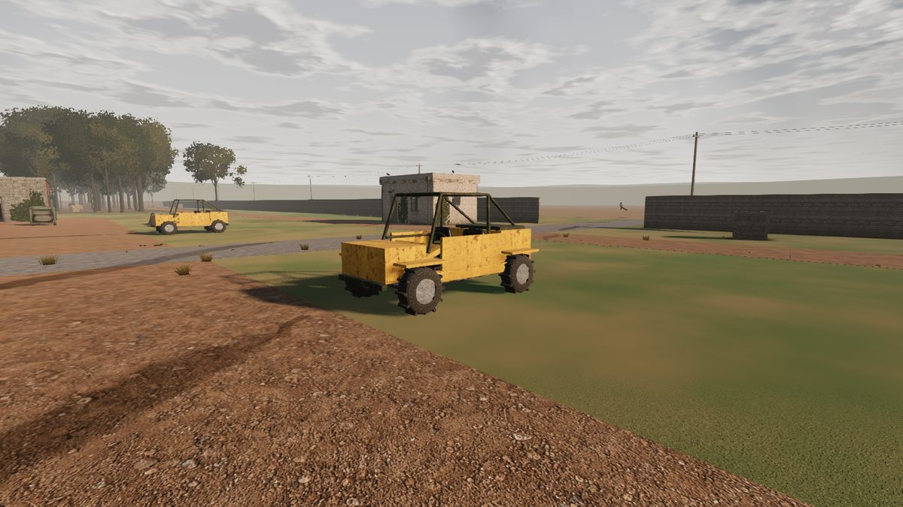 |
| 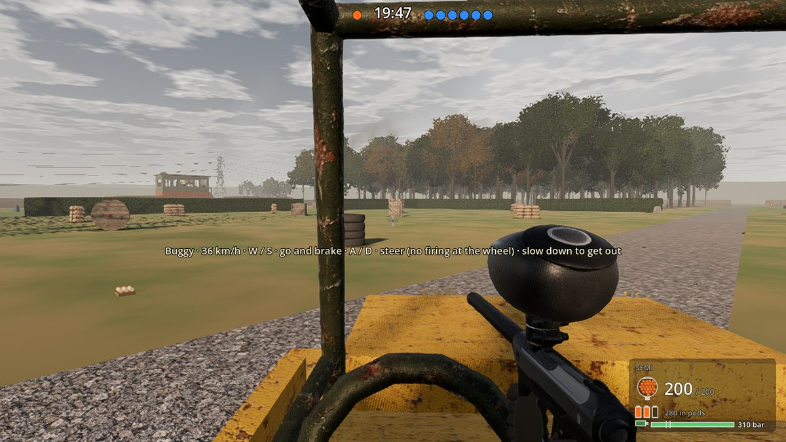 | 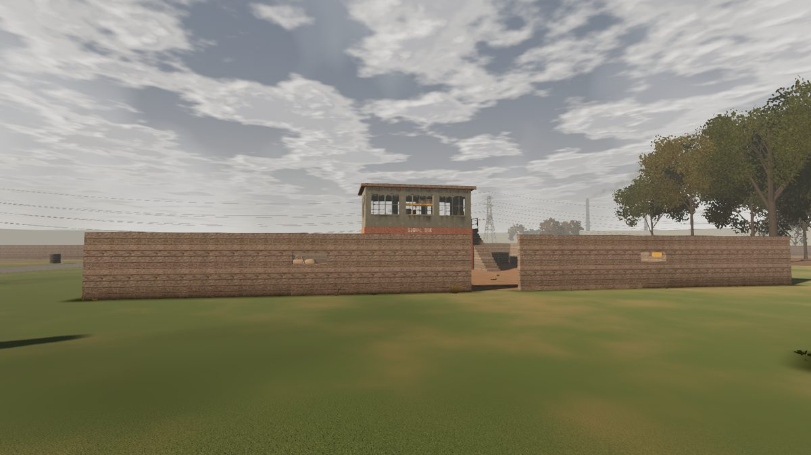 |

Captured under lavapipe at the low preset: the level's viewpoints (`--shots`), two close views of the buggies
(`--views`), and `--vehicle-demo` at 4 frames a second (`--fast`).

### How to run it

```bash
godot --path game res://scenes/Level.tscn -- --level=thornwick_woods --mode=teams --size=4 --objective=flag
godot --path game res://scenes/Level.tscn -- --vehicle-demo --level=thornwick_woods     # you drive a buggy down the tracks
godot --headless --path game res://scenes/Level.tscn -- --bot-match --mode=teams --size=4 --objective=flag --level=thornwick_woods --seed=7 --min-drives=1 --no-art
python3 tools/levels/thornwick_woods.py game/data/levels                                # regenerate the level after editing the script
```

Or pick Thornwick Woods in the menu.

### Checks

| Check | Result |
|---|---|
| `dotnet test tests/Pb.Sim.Tests` | 535 passed (41 new: 7 for the buggies, 5 for the site, the rest the site in the tests run on every area and place) |
| `dotnet test tests/Pb.Net.Tests` | 71 passed (1 new) |
| `tools/ci/smoke-test.sh` | 40 runs (4 new). 39 passed in the full run; the menu run failed: with a fifth area its cards were too tall for the screen. Fixed (below), it passed when run again. |
| `dotnet run -c Release --project tools/Pb.Bench` | Thornwick Woods: a tick with 1,000 balls 0.25 ms (Oxbarrow Works 0.19); with 10 players 0.40 ms against the 0.5 ms budget. The server's tick over the network 0.43 ms (p95 0.49), every budget within. The bots' brains 0.01–0.09 ms a tick. The grid built in 1.4 s in a Release build. |

New tests and runs:
- `VehicleTests`: getting in at the door, driving and getting out beside it (not while it's fast); steering, and
  tighter with more of it; a wall stops it, and so does anyone in its way, unharmed; the driver can't fire and the
  passenger can; someone hit gets out and it rolls to a stop; paint breaks on its body; a new round puts it back.
- `ThornwickWoodsTests`:
  - its size, woods, tracks and buggies; the grid's build time;
  - long paths across it and their search times; the tracks joining up (T-junctions included);
  - a bot going 190 m driving a buggy up the lane and walking the rest (in at 2.7 s, out by the north gate at 25 s,
    at its goal at 26 s; on foot it'd be 35 s at a run).
- `NetRoundTests`: a buggy drives the same on every copy, its driver riding where it's drawn, in and out.
- Smoke:
  - the level walk-through on Thornwick Woods: 5 climbs, a door, a duel;
  - a 4 v 4 round;
  - a 4 v 4 capture the flag on a fixed seed that must see bots take the wheel (two drives; won by clearing the other
    side in 101 s);
  - `--vehicle-demo`: in, 171 m along the tracks round the crossroads, out, with your body, the drawn buggy and the HUD
    checked all the way.

### Known issues

- **The ground is flat.** The plan had rolling ground (a height field in the sim's collision); the site's cover is its
  woods, hedges and buildings instead. Rolling ground is the next step for this map.
- **A joined driver isn't predicted.** On a joining copy you ride where the server's buggy is drawn, so the controls
  answer after the round trip, much as everyone else is shown. Fine on a LAN, sluggish on a slow link.
- **Bots drive only for long trips.** In plain team rounds the bots' goals are mostly near (hunting the nearest
  spots), so they seldom drive. In capture the flag, retrieve and hold across the site they do. Bots never ride as
  passengers.
- **Seated characters crouch.** There's no sitting clip yet: a seated character is posed crouched, its legs hidden in
  the buggy's tub.
- **Load time.** About 11 s headless on this container: the grid 3 s, and the level's dressing (88,000 weed tufts along
  the tracks, the fence and the yards, the cracks, the splats) 7 s. The other areas take 3–5 s. Fewer tufts, or tufts
  grown after the round starts, would bring it down.

### What's next

PR D: the Windows build to share.

## M5.6 (E) — Firing from the wheel

**Branch:** `claude/eager-cannon-c05kkv-drive-fire` (on C2's)

### What was built

Tim's call on C2: the driver must be able to shoot while driving, players and bots alike.

- **The rule.** The driver's seat fires, one-handed, with the other hand on the wheel. Shots take the marker's spread,
  already wider at the buggy's speed, times the seat's `spreadScale` (2, in `vehicles.jsonc`). A passenger fires as
  before. Paint on a buggy still never counts, and everyone in it can be hit and put out as before.
- **Bots fire from the wheel.**
  - With an enemy in sight, a driving bot looks at it to make it out. Once it has engaged, it aims and fires as on
    foot.
  - It drives on at no more than 5 m/s (`driveFightSpeed_mps`), steadier to shoot from. Where to stand or take cover
    means nothing in a vehicle, so goals the fight sets are ignored.
  - An enemy within 14 m (`driveFightOutWithin_m`) gets it out to fight on foot. Before, any enemy in sight within 70 m
    did.
- **Two bugs fixed on the way.**
  - A bot's trigger waited for it to be nearly still unless its archetype fires on the move, so a seated bot never
    fired. Riding isn't walking, so a seated bot now fires.
  - The moment an enemy came into view, its last-known spot was still unset (the origin). A bot driving within the old
    range of the origin got out for an enemy that was 45 m away. The range is now measured to where the enemy is.
- **The HUD.** At the wheel it says "you fire one-handed (wider)".

### How to run it

```bash
godot --path game res://scenes/Level.tscn -- --level=thornwick_woods --mode=teams --size=4
```

Get in a buggy's driver's seat with F and fire as usual.

### Checks

| Check | Result |
|---|---|
| `dotnet test tests/Pb.Sim.Tests` | 536 passed (1 new, 1 rewritten) |
| `dotnet test tests/Pb.Net.Tests` | 71 passed |
| `tools/ci/smoke-test.sh` | The runs E touches passed here: the four on Thornwick Woods (a 4 v 4 saw 2 drives; capture the flag ended in a capture after 148 s), a 3 v 3 and the menu. CI runs the whole suite on the PR. |

New tests:
- `VehicleTests.The_driver_fires_one_handed_and_wider_a_passenger_as_usual`: both seats fire. Over eight seconds of
  fire, sitting still, the driver's shots spread 0.82° on average against the passenger's 0.40°.
- `ThornwickWoodsTests.A_driving_bot_shoots_from_the_wheel_and_drives_on`: a bot driving up the lane passes an enemy
  24 m off it. It sees, spots and engages it, fires 8 shots from the wheel, puts it out, and drives on (211 m in all).

### Known issues

- The seated characters still crouch with the marker up; the seated driving clips (hands on the wheel, one hand up to
  aim) come with F.

### What's next

PR F: the buggy's handling, sound, camera and seated animation, and the joined driver's prediction.

