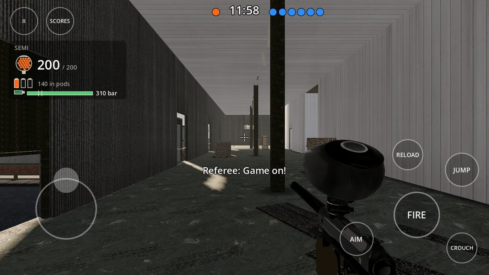
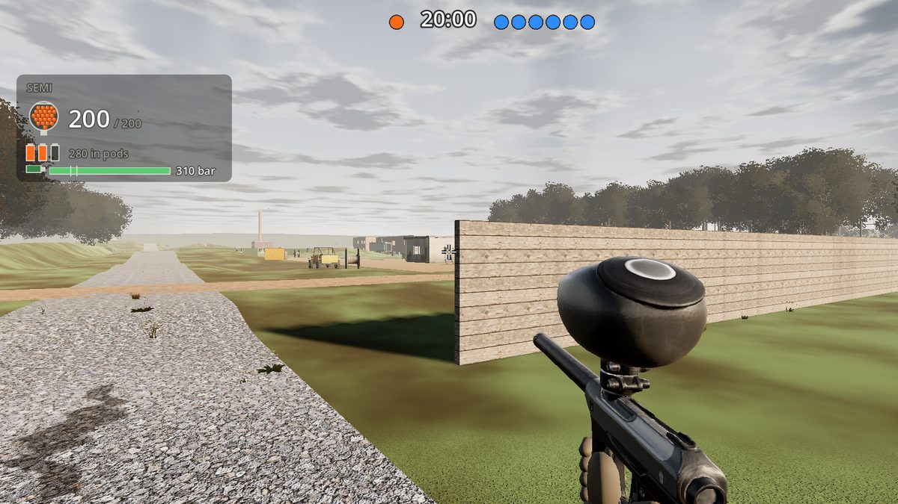
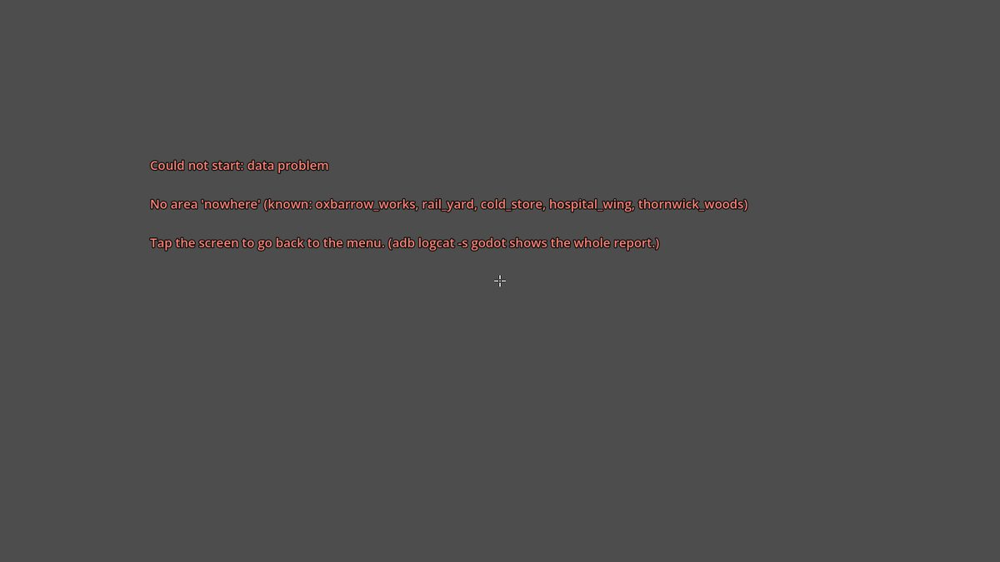

# Phase 6 report — Pb on Android

The plan is [phase-6.md](../phase-6.md); the design is [architecture.md §19](../architecture.md#19-phase-6-pb-on-android).
Each part below is its own pull request, stacked on the one before.

## M6.1 (A) — The Android build

**Branch:** `claude/eager-cannon-c05kkv` (on main, after Phase 5)

### What was built

- **An Android export preset** for 64-bit ARM phones (arm64-v8a) running Android 7.0 or later: landscape either way
  round, full screen, with the network permission for playing with others. The package is `org.pbgame.pb`, called
  "Pb", with a new icon (the title mark's orange splat with "Pb" stencilled on it, drawn by
  `tools/package/android/make-icon.py`; it's the desktop window's icon now too).
- **C# on Android.** Godot's Android template only takes .NET 9, so the game targets net9.0 when it's built for Android
  and stays on .NET 8 everywhere else. The APK carries the Mono runtime and the game's three assemblies.
- **Full screen stays full screen:** on a phone the settings' window mode (windowed, on a computer's first run) isn't
  applied; asking Android for a window would bring its bars back.
- **The art in the APK**, its textures in the phone formats: the project now imports each texture as ETC2/ASTC as well
  as S3TC/BPTC (each `.import` lists both; every export takes the ones its platform reads).
- **`tools/package/android-build.sh`** makes `builds/android/Pb.apk`. It uses Godot's release template (the debug one
  costs frame time), signed with a debug key kept in the repository (`tools/package/android/debug.keystore`). Every
  build installs over the one before, and none is fit for a store. The version name is the build's stamp, the version
  code CI's run number. It drops 60 MB of static libraries that come with .NET's runtime pack (no phone loads them),
  aligns and signs the APK again, and checks it: the signature, arm64 alone, the permission, the version, the engine,
  the runtime, the assemblies, the data and the art in its phone formats. The APK is about 230 MB.
- **CI's "Android build" job**, after the smoke test like the Windows build: it builds the APK and uploads it with
  `HOW-TO-INSTALL.txt` as the **Pb-android** artifact.
- **Docs:** [docs/android.md](../android.md) (getting the APK, installing it on the phone or over USB with adb,
  updating, removing it, logs, building it yourself), `HOW-TO-INSTALL.txt` beside the APK, and the README's "Play it".

### How to run it

```bash
python3 tools/package/fetch-templates.py 4.7.2 android_release.apk
ANDROID_HOME=~/android-sdk tools/package/android-build.sh path/to/godot      # builds/android/Pb.apk
adb install -r builds/android/Pb.apk
```

It needs the Android SDK's build tools, a JDK and the .NET 9 SDK as well ([docs/android.md](../android.md#building-it-yourself)).

### Checks

| Check | Result |
|---|---|
| `tools/package/android-build.sh` | Builds and checks `Pb.apk` here: 230 MB, `org.pbgame.pb`, arm64-v8a only, Android 7.0 (API 24) to 16 (API 36), signed with the Pb debug key, the network permission, Godot's engine, the Mono runtime, `Pb.dll`, `Pb.Sim.dll` and `Pb.Net.dll`, the data, the build stamp, and 126 textures in their phone formats. Vulkan is wanted but not required, so a phone without it falls back to OpenGL ES 3. |
| `dotnet test` | 567 sim tests and 73 network tests pass (built with the .NET 9 SDK, which `global.json` now rolls forward to here; CI's other jobs stay on .NET 8). |
| Smoke runs | The menu, the range, Oxbarrow Works' walk-through and a bot match, Thornwick Woods' walk-through and the vehicle demo pass with the new project settings (the icon, the orientation, the phone texture formats). CI runs the whole suite, the Windows build and the new Android build. |

### Known issues

- **Not run on a phone.** There's no phone here and no emulator (this container has no hardware virtualisation), so
  the APK is built and checked, not started. Whether it starts, and how it runs, needs a phone.
- **No touch controls yet:** the menus work by tapping (touches act as clicks), but a round needs a game pad until
  M6.2. It uses Godot's Mobile renderer, Godot's default on Android, with the desktop's Medium preset until M6.3.
- The APK is big (about 230 MB), nearly all of it the art and the engine.

### What's next

M6.2: touch controls (a stick to move, drag to look, the buttons, driving), and menus that fit a phone.

## M6.2 (B) — Touch controls and menus by touch

**Branch:** `claude/eager-cannon-c05kkv-touch` (on M6.1)

### What was built

- **Touch controls**, drawn over the HUD, sized in millimetres from the screen's density and kept inside its safe area
  (clear of a notch or a camera hole). A **stick** appears where the left thumb lands (pushed out past its ring, you
  sprint); **dragging** anywhere on the right that isn't a button looks round, and so does dragging on FIRE as you hold
  it. On foot: **FIRE**, **AIM** (a tap on, a tap off: the view narrows to 80 % and the look slows; it changes nothing
  the sim decides), **JUMP**, **CROUCH** (a tap down, a tap up), **RELOAD**, and **USE**, which shows only when there's
  something in reach and says what it'll do: GET IN, GET OUT, OPEN, SHUT, CLIMB, CLIMB DOWN. **At the wheel** the stick
  steers and the buttons become **GAS**, **BRAKE** (then reverse), **HANDBRAKE**, **FIRE** from the wheel and **GET OUT**
  once you're slow enough. Along the top: **pause**, **SCORES** (held) and, playing with others, **CHAT**. The layout's
  all in presentation.jsonc (`touch`).
- **Up automatically:** on a phone or tablet from the start; on a computer at the first touch of its screen, and away
  again at a mouse click, a key or a game pad (a phone with a pad plays with the pad until the screen's touched again).
  The training ground has them too.
- **Settings, Controls:** touch look speed, button size, how see-through they are, and **left-handed** (the sides
  swapped). On a phone, what only a computer has (the mouse's sensitivity, key bindings, the window mode) is left out,
  and the window mode isn't applied (it took the game out of full screen on Android; fixed in M6.1's pull request).
- **Menus by touch:** on a phone the whole interface is drawn bigger by the screen's density (an interface pixel 0.13
  mm, at least 480 of them in the screen's height): about 1170 × 530 on a 6.5-inch phone, 850 × 480 on a small or 16:9
  one. Every menu fits that: narrow margins, nothing wider than the screen, the level card's columns stacked, Play with
  others' hosting and joining stacked, choices that wrap, the title's buttons beside its mark, the briefing's Start and
  Back first, cards over the round in pages that scroll, and pages that scroll by dragging (panels let the drag through).
  Text boxes bring up the phone's keyboard (Godot's own). The phone's **back** button goes back a screen, leaves the
  game from the title, and in a round leaves the chat, steps back in the pause menu or opens it. The HUD's prompts
  name the touch buttons, and the gear panel moves up out of the buttons' way.
- **Two demos that are also tests:** `--touch-demo` plays a round on Thornwick Woods by simulated fingers, the touches a
  phone sends, and `--menu-touch-demo` works the menus by taps and drags (both below).

### How to run it

```bash
godot --path game res://scenes/Level.tscn -- --touch --dpi=200          # a round with the touch controls, on a computer
godot --headless --path game res://scenes/Level.tscn -- --touch-demo --level=thornwick_woods --no-art --dpi=400
godot --headless --path game res://scenes/Main.tscn -- --menu-touch-demo --dpi=480 --screen=1920x1080
```

On a computer with a touch screen the controls come up at the first touch. `--safe-area=L,T,R,B` (screen pixels) makes
a notch.

### Checks

| Check | Result |
|---|---|
| `--touch-demo` | Passes all 30 steps on Thornwick Woods, by simulated fingers alone: Start tapped on the briefing; the buttons inside the safe area and clear of each other, on foot and at the wheel; a 2 cm drag turns 60.0° (30 °/cm) and back; the stick pushed near its ring moves you at 5.2 m/s and, pushed past it, sprints (7.0 m/s); JUMP leaves the ground; CROUCH down and up; AIM narrows the view and lets it go; FIRE held fires while a drag on it turns you; RELOAD starts a refill; USE says GET IN at the buggy's door and gets you in; GAS with the stick to one side drives and turns (up to 24 km/h, 60° round in 2.5 s); HANDBRAKE goes on; FIRE from the wheel; BRAKE stops it; GET OUT; SCORES held shows the scoreboard; pause by its button, the back button closes and opens it, Resume tapped; left-handed swaps the sides. On a 20:9 phone (2400 × 1080, 400 dpi) with a notch either side, a 16:9 one (1920 × 1080, 480 dpi) with a notch on one side, and a small one (1600 × 720, 300 dpi). |
| `--menu-touch-demo` | Passes its 13 steps at the same three sizes (about 1170 × 530, 850 × 480 and 1070 × 480 interface pixels): every screen within the screen's width, the title's buttons all in sight, Play, a place picked, the level card dragged until Start is in reach (dragging scrolls the page), the back button, Settings with the touch settings and none of the mouse's, the Video tab tapped (no window mode), Play with others, the name box taking the tap, and the back button on the title leaving the game. |
| Rendered (lavapipe) | The touch demo filmed on a 16:9 phone-sized screen passes the same 30 steps; the frames show the controls where they should be: pause and SCORES at the top left with the gear panel under them, the stick's ring at the bottom left, FIRE, AIM, RELOAD, JUMP and CROUCH by the right thumb, GAS, BRAKE, HANDBRAKE, FIRE and GET OUT at the wheel, and GET IN by the buggy. |
| `dotnet test` | 568 sim tests (one new: the touch settings kept in their ranges) and 73 network tests pass. |
| Smoke runs | The menu, the range, Oxbarrow Works' walk-through and a bot match, the splat and duel demos pass as before (a computer without a touch screen plays as it did); CI runs the whole suite with the five new touch runs. |

### Known issues

- **Not tried by a thumb.** Every touch here is simulated (the same events a phone sends, through Godot's input), so
  how the controls feel (the look speed, the stick's size and where the buttons sit for a real hand) needs a phone and
  a person; the sizes are a starting point, and Settings changes them.
- No lean, shoulder swap, walk, fire mode or callout buttons: the brief's buttons only, to keep the right thumb's
  cluster small. A pad has them all.
- The phone's own keyboard and its back button are Godot's: shown and sent by Android, not seen here.

### What's next

M6.3: a mobile graphics preset (the Mobile renderer, lower shadows, effects and view distance) and its benchmark.

## M6.3 (C) — The mobile graphics preset and its benchmark

**Branch:** `claude/eager-cannon-c05kkv-mobile` (on M6.2)

### What was built

- **A "mobile" graphics preset**, the one a phone starts on, drawn by Godot's **Mobile renderer** (Vulkan; a phone
  without Vulkan falls back to Compatibility, OpenGL ES 3, where the view is scaled up plainly instead of with FSR):
  - **shadows:** one split instead of four, 1024 px, out to 40 m;
  - **effects:** no ambient occlusion, bounced light, reflections, fog volumes, glow, sunbeams, dust or window lights;
  - **view distance:** the woods drawn to 60 % of their range, and every mesh's detail dropped sooner (Godot's LOD
    threshold at 4 px rather than 1);
  - **weeds and dressing:** a quarter of the weeds, out to 18 m; nothing lying on the ground, and no old paint;
  - **menus:** no 3D scene behind the main menu.

  Three of these are new parts of a preset (`shadowSplits`, `viewScale`, `lodThreshold_px`), and so is `menuBackdrop`.
  The desktop presets are unchanged.
- **A phone's starting settings:** the mobile preset, the 3D view drawn at 75 % and scaled up, and a 30 fps cap. The
  cap keeps the frame rate steady (a phone that can't hold 60 swings between 60 and 30, which judders) and the phone
  cooler. Settings, Video changes any of them.
- **The benchmark, `--mobile-bench`:** it rides on a run on Thornwick Woods and, as the run quits, fails it past a
  budget in presentation.jsonc (`graphics.mobileBudget`).
  - **Drawn**, on the Mobile renderer, it counts each frame's draw calls and triangles, shadows included. That's what a
    phone's GPU is asked to draw, the same on any GPU.
  - **Headless** it times the game's own work for a frame at 30 fps: scripts, the sim's ticks and animation.
  - `tools/ci/mobile-bench.sh` runs it on two scenarios: the vehicle demo (a buggy driven along the tracks, the
    handbrake, a burst from the wheel) and a 4 v 4 team round with bots fighting and taking the buggies' wheels. Each
    scenario runs both drawn and timed.
  - CI's new **Mobile benchmark** job runs that script on Mesa's software Vulkan.

### How to run it

```bash
xvfb-run -a -s "-screen 0 1280x720x24" godot --path game --rendering-driver vulkan --rendering-method mobile --resolution 1280x720 \
  --fixed-fps 5 res://scenes/Level.tscn -- --level=thornwick_woods --vehicle-demo --fast --mobile-bench   # the counts
godot --headless --path game --fixed-fps 30 res://scenes/Level.tscn -- --level=thornwick_woods --vehicle-demo --fast --mobile-bench
tools/ci/mobile-bench.sh godot                                                                           # CI's four runs
```

### Checks

| Check | Result |
|---|---|
| The drive, drawn (Mobile renderer, lavapipe) | 394 draw calls typically, 536 at the 95th percentile, 596 at most; 421,000 triangles typically, 621,000 at the 95th, 678,000 at most: within the budget (700, 750,000). |
| The round, drawn | Bots fighting and driving: 283 draw calls typically, 517 at the 95th, 608 at most; 484,000 triangles typically, 612,000 at the 95th, 685,000 at most. |
| The game's own work, timed headless | 2.9 ms a frame at 30 fps on the drive and 3.3 ms in the round, on average (3.9 and 4.4 at the 95th percentile): within 6 ms, so roughly 9–10 ms of a phone's 33 ms frame. |
| Against the desktop | The desktop's Medium preset on Forward+ draws 1,040 draw calls and 1,240,000 triangles (95th percentile) on the same drive: the mobile preset halves both. Without the woods the drive draws about 130,000 fewer triangles and much the same draw calls; the rest is the ground, the weeds, the characters, the buggies and the dressing. |
| `dotnet test` | 569 sim tests (one new: a phone starts on the mobile preset, at 75 % and capped at 30 fps, and keeps what its player chose) and 73 network tests pass. |
| Smoke runs | The menu, the range, Oxbarrow Works' walk-through and a bot match, the vehicle, splat and duel demos, and the touch and menu-touch demos pass as before; CI runs the whole suite and the new Mobile benchmark job. |

### Known issues

- The budget (700 draw calls, 750,000 triangles, 6 ms of the game's work a frame on the bench's machine; 850 draw calls
  since M6.4, on the Compatibility renderer) is what a 2023 mid-range phone's GPU and CPU should handle at 30 fps. It's
  an estimate from counts, not a frame rate measured on one.
- A phone's GPU cost is mostly filling pixels. The leaves and weeds are alpha-cut cards, the costliest thing for a
  phone's tile-based GPU, and only a phone can measure them. If Thornwick Woods doesn't hold 30 fps on a mid-range
  phone, the first things to try are keeping the frame cap at 30 and fewer weeds (Settings, Video, Weeds: None), then a
  lower `viewScale`. A lower render scale comes last: since M6.4 it's scaled up plainly on a phone, never with FSR,
  and it hasn't been tried on one.

## M6.4 (D) — The grey screen on a phone

**Branch:** `claude/eager-cannon-c05kkv-android-fix` (on M6.3)

Tim installed M6.3's APK (CI's **Pb-android** from that pull request) on his phone. The menus worked, but after Start
the view stayed grey with the desktop's CONTROLS help over it, and the help never faded. A render scale of 100 % made
no difference.

### What was wrong

- **The level stopped as it started.** Android's .NET runtime is Mono, and Mono's garbage collector has a single
  latency mode: asking it for any other throws `PlatformNotSupportedException`. Near the start of its setup the level
  asked for low latency, to keep full collections out of a round (a Phase 5 fix for hitches on the desktop). That was
  before it built the world, the camera or the HUD, so the throw left a grey view with the HUD's first frame on it.
  .NET's own runtime, which every desktop build and CI run on, takes the call, so nothing here showed it.
  Decompiling Android's `System.Private.CoreLib` (from the runtime pack the APK carries) confirms the throw.
- **Why the help never faded:** the help fades in the HUD's frame update, which waits until the level has set the HUD
  up, and the level never got that far. The game wasn't paused.

### What was built

- **The fix:** `GcModes` asks for low latency only where the runtime can give it. A new sim test fails if any other file
  sets the collector's modes; it would have caught this. The up-front compiling (`JitWarmup`) skips anything Android's
  runtime won't compile ahead of time, instead of throwing.
- **No more silent grey:** if anything stops a level as it starts, the screen says what went wrong and the log has the
  whole report. A tap or the back button (on a computer, a click or a key) goes back to the menu; in CI the run fails.
  The round's start also unpauses the game, in case anything had paused it.
- **The renderer:** a phone now draws with Godot's Compatibility renderer (OpenGL ES 3) instead of the Mobile renderer
  on Vulkan, with no MSAA or occlusion culling and a 1024 px shadow atlas. The desktop is unchanged (Forward+, MSAA,
  occlusion culling, 4096 px). Three things drew differently under Compatibility, checked on Mesa's OpenGL ES:
  - Thornwick Woods' weathered walls and props asked for more per-object shader values than Compatibility holds (231
    errors as it loaded). There those values come from the material, and each door gets its own copy.
  - The overlays that darken what's under them (contact shadows, cracks, footprints, wet prints) came out darker,
    because Compatibility blends in the screen's colours rather than in linear light. They're lifted there to match.
  - Glow turned the ground's overlays black, so it's off under Compatibility (the mobile preset had it off anyway).
- **Render scale:** a phone starts at 100 %, and a lower scale is scaled up plainly, never with FSR.
- **The desktop's CONTROLS help** isn't shown on a phone.
- **A `RENDER:` line in the log**, as the menu and each level start: the renderer, its driver, the GPU, the 3D view's
  scale and how it's scaled up, MSAA, the window and the phone's model. `adb logcat -s godot` shows it.
- **The benchmark** now draws the way a phone does: with the Compatibility renderer (on Mesa's OpenGL ES) and occlusion
  culling off. The same frames take about 40 % more draw calls there than on the Mobile renderer, so the draw-call
  budget is now 850 (it was 700). The triangles and the game's own work are much as before.
- **Docs:** [android.md](../android.md) (the renderer; the frame cap and the weeds as the first things to change if a
  phone stutters or gets hot, not the render scale; the `RENDER:` line), architecture §19.3–19.4, this report, the plan,
  CLAUDE.md and the README.

### How to run it

```bash
# What a phone draws, without a phone (apt-get install xvfb libegl1 libgles2 libegl-mesa0):
xvfb-run -a -s "-screen 0 1600x900x24" godot --path game --rendering-method gl_compatibility --rendering-driver opengl3_es \
  res://scenes/Level.tscn -- --level=cold_store --place=store --preset=mobile --touch
tools/ci/mobile-bench.sh godot                     # CI's benchmark, on the Compatibility renderer
adb logcat -s godot | grep -E "RENDER|ERROR"       # on a phone: what it draws with, and any errors
```

### Checks

| Check | Result |
|---|---|
| The cause | Android's `System.Private.CoreLib`, decompiled: the `GCSettings.LatencyMode` setter throws `PlatformNotSupportedException` for any mode but its own. The new test flags the two lines in M6.3's level that set it, and none now. |
| Drawn as a phone draws it (the Compatibility renderer on Mesa's OpenGL ES 3.2, the mobile preset, the touch controls) | The cold store from your own view as the round starts, Thornwick Woods and Oxbarrow Works: the world drawn and no errors; acting as a phone, no CONTROLS help (pictures below). Before the shader fix, Thornwick Woods logged 231 errors there. |
| A level that can't start | Headless, `--level=nowhere` logs "Could not start: data problem: No area 'nowhere' …" and exits 1. Drawn, the screen says so and how to go back (below). |
| The duel and splat demos on Compatibility | Both pass: the arcs on screen and HIT! once; 12 of 14 paint cards painted (Compatibility has no decals, so paint goes on cards there). |
| Contact shadows on Compatibility | The floor under one measured 35.5 on Forward+ and 27.2 on Compatibility (mean pixel value); lifted, 36.2. |
| The benchmark, drawn on Compatibility (occlusion culling off, as on a phone) | The drive: 751 draw calls at the 95th percentile (506 typically), 634,000 triangles. The round: 741 (417 typically), 615,000. Both within 850 and 750,000. With occlusion culling on, as a computer has it, they drew 740 and 729, so a phone loses little with it off. |
| The benchmark, timed headless | The game's work: 3.5 ms a frame at 30 fps on the drive and 3.8 ms in the round, on average (4.6 and 5.5 at the 95th percentile): within 6 ms. |
| `dotnet test` | 570 sim tests (one new: only `GcModes` sets the collector's modes) and 73 network tests pass. |
| Smoke runs | 17 of CI's runs pass: the menu, the range, Oxbarrow Works' walk-through and a bot match, the cold store's and Thornwick Woods' walk-throughs, a Thornwick Woods bot match, the vehicle, splat and duel demos, an art match, the touch demo at two phone shapes, the menu-touch demo at three, and the art check. CI runs the whole suite. |
| `tools/package/android-build.sh` | Builds and checks `Pb.apk`: 230 MB, `org.pbgame.pb`, arm64-v8a only, signed with the Pb debug key, 126 textures in their phone formats. Its manifest asks for OpenGL ES 3.0 and nothing of Vulkan, and its project settings carry the `.mobile` overrides (Compatibility, no MSAA, no occlusion culling, a 1024 px shadow atlas). |







### Known issues

- **Not run on a phone yet.** The fix removes the cause found in the code (the one that leaves exactly that grey
  view), checked against Android's own runtime library, but only a phone can show the world now appears. If anything
  else stops a round on a phone, the screen now says what, and `adb logcat -s godot` has the whole report.
- The new test covers the collector's modes. Any other call Android's runtime turns down would only show on a phone,
  though now on the screen rather than as a grey view.
- Compatibility has no decals (paint goes on cards, as it did before on Compatibility), no glow and no FSR. Its sun
  shadow and its light are close to the Mobile renderer's but not the same, and they're judged here on Mesa's
  software renderer, not a phone's GPU.
- The draw-call budget went up with the renderer (850, from 700). It's still an estimate from counts. Draw calls cost a
  phone's CPU, so if a round stutters with the frame cap at 30 and the weeds off, they're the next thing to look at.

### What's next

Tim installs this build over the last one: does a round start, with the world drawn? Its `RENDER:` line (`adb logcat
-s godot`) says what it drew with; if a round still can't start, the screen says why.

## What couldn't be tested without a real device

There's no phone here, no Android emulator (no hardware virtualisation) and no GPU. Everything was checked short of a
phone:

- the APK was built and checked: signature, contents, manifest and the art in its phone formats;
- every touch was simulated with the same events a phone sends;
- the Mobile renderer was drawn on Mesa's software Vulkan, and since M6.4 the Compatibility renderer (what a phone now
  draws with) on Mesa's software OpenGL ES 3.2;
- since M6.4, the call that stopped the level on Tim's phone was checked against Android's own runtime library
  (decompiled), as no Android runtime runs here.

What only a phone can show:

- **That a round now starts and the world appears** (M6.4's fix): Tim's phone ran the APK and its menus, so the .NET
  runtime on Android, the first launch and the menus are known to work; loading Thornwick Woods within a phone's
  memory isn't yet.
- **The frame rate,** and whether it holds a steady 30 fps on a mid-range phone. The bench gives the counts and the
  game's CPU time, not a phone's GPU time, and the alpha-cut foliage and the full-screen passes are the unknowns.
- **Heat and battery** over a long round (the 30 fps cap is there for them).
- **A phone's own OpenGL ES driver** (an Adreno's, a Mali's, a PowerVR's): the Compatibility renderer was drawn here on
  Mesa's software one only, and phones' drivers differ in what they hold (the per-object shader values that overflowed
  on Thornwick Woods, for one) and in their shader compilers.
- **How the controls feel under a real thumb:** the look speed, the stick's size, and where the buttons sit (all
  adjustable in Settings).
- **The phone's own keyboard, back button, safe area and notch:** simulated here, shown and sent by Android there.
- **Playing with others from a phone over Wi-Fi:** finding games on the network, and hosting on one.
