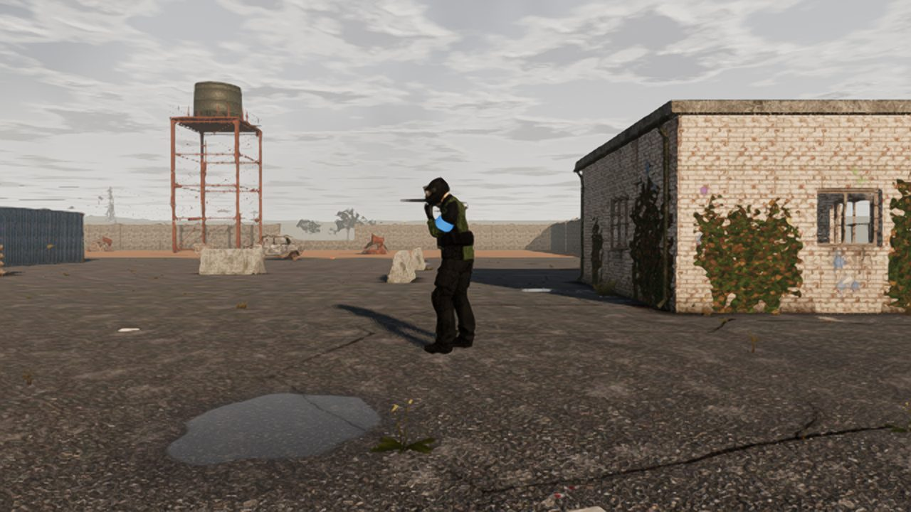
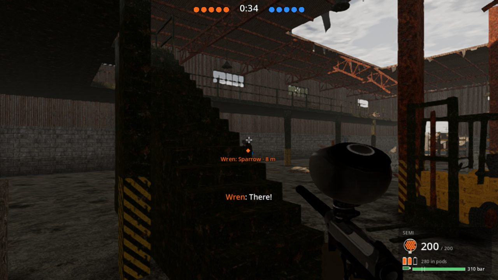

# Play-test fixes (after Phase 4)

**Date:** 2026-10-31 · **Branch:** `claude/ecstatic-wright-kquxtm`

Tim's play-test of Phase 4 raised seven things:
- voiced callouts were overdone;
- the referee's whistle at the start of a round was unwelcome;
- the characters looked glitchy;
- spawns and roles didn't really vary, and the bots stood still;
- the game hitched;
- objective rounds were badly paced;
- one network test failed on Linux.

Each was looked into before it was fixed. The fixes are measured against the game as it was, on the same machine with
the same seeds wherever the comparison allows. The design notes are [architecture §17](../architecture.md#17-after-the-phase-4-play-test-2026-10-31-as-built).

## 1. Fewer callouts, and the ones that matter reach the right teammates

**What was wrong:**
- **Too many lines.** Every bot shouted its callouts as often as its own cooldown allowed. Five bots spotting you meant
  five "Contact!"s. In 90 s of a 5 v 5 the old settings gave **30** lines.
- **"Callouts heard 0" was a counting fault.** The headless log counted only presses of *your* callout key. In a bot
  match nobody presses it, so the count was always 0. The bots' contacts did reach their teammates; the log never
  counted them.

**What changed:** shouting is decided in the sim (`bots/brain.jsonc`):
- a 10 s cooldown per bot, and no repeating the same call within 30 s;
- 55 % of everyday calls said aloud ("Hit!" and the case calls always are);
- one shout per side every 5 s, and no teammate echoing a call within 20 s;
- 1.5 s between any two lines in the round, so lines never overlap.

Passing a contact to teammates is separate from saying it, and is unaffected. The log now counts lines shouted,
contacts shared and contacts heard, and a bot teammate's "Contact!" marks the enemy on your HUD.

**Now:** 30 → **6** lines in the same 90 s. In CI's 3 v 3 round, 3 lines were shouted, 10 contacts shared and 6 heard
by teammates.

**Tests:** `CalloutTests`:
- every gap is kept over 2 minutes of a 5 v 5;
- the old settings give more than twice the shouts;
- every teammate in earshot hears a call, and the other side never does;
- the counts add up.

## 2. No whistle at the start of a round

**What was wrong:** a breakout horn and "Game on!" started every round, with more lines on top:
- the thirty-second call, with whistle pips;
- room calls every few seconds in a doorway fight.

**What changed (`presentation.jsonc` → `hud.refereePacing`):**
- The round goes live on a soft two-note knock (`startCue: "soft"`; `"horn"` brings the old horn back, `"none"` has
  nothing), and "Game on!" follows it.
- The thirty-second call is off.
- Room calls wait 2 s for the room to settle and don't repeat within 30 s.
- Everyday lines are at least 8 s apart.
- The whistle stays for the end of the round.

**Verified:** the cue is synthesised like every other sound (`--sounds` writes it out as a WAV file to listen to),
and the level smoke test checks the referee still calls the round (`RefereeCalls.Called`).

## 3. Steadier characters

**How it was measured:** the gait demo now prints three things for each move and for going into it:
- planted-foot slide;
- the head's and hands' jerk against the body;
- how far the wrists and ankles end up from their marks.

A bot match with the art prints the worst pop of any character in the round.

**What was wrong, and what changed:**

| Problem | Fix | Before | After |
|---|---|---|---|
| Running, a foot stayed down so long that the body outran the leg and dragged it | Quicker strides, with more of each stride in the air (`steps.gaits`) | 0.72 m/s slide | 0.16 m/s |
| The hips snapped down in one frame whenever a leg needed reach, and the bob turned a corner at each landing, so the head and hands popped | The drop eases over 20 ms; the bob and sway are smooth waves | Jerk 2.2 / 2.8 cm (run / sprint), 3.2 strafing, 2.9 backing off | 0.4 / 0.5, 1.4, 1.5 |
| Crouching and standing went at full speed from the first frame | The drawn body follows the sim's eye height on a 30 ms spring | Hands 6.3 cm a frame | 2.7 cm |
| A shoulder swap traded the grips in one frame | The hands ease across over 0.15 s | 21.5 cm | 8.3 cm |
| Setting off, or reversing a strafe, left the planted foot out of reach, and it skated after the body for a step | That foot steps at once, or the cycle hurries so the other lands sooner (`steps.stepWhenDragged_mps`, `draggedHurry`) | At 120 fps: 0.53 m skated starting a walk, 0.60 m starting a strafe, 0.50 m reversing one; strafe-left slide 0.43 m/s | 0.18, 0.19 and 0.29 m; 0.13 m/s |
| A character's first frames drew its hands at the world's origin | Fixed | 82 cm pops | none |

**Now:** in an art-on 3 v 3 the worst pop of any character is about 2-5 cm, from aiming and being hit.

**In CI:** the smoke test now runs two new checks.
- `--gait-demo --gait-check` fails past these limits:
  - 0.3 m/s of slide;
  - 2.5 cm of jerk in a move, or 4 cm going into one;
  - wrists 1 cm off their grips, ankles 3 cm off their marks.

  It passes at both 60 and 120 fps.
- An art-on bot match fails if any character pops more than 15 cm (`--max-pop=15`).

## 4. Starts and roles that change every round, and bots that move about

**Why it didn't play that way:** each round did get a new seed, but:
- **Narrow spawn areas.** The Hospital Wing's spawn area was its car park and the Cold Store's its lorry park, so nobody
  ever started inside either building (about 35 possible starts on the Hospital Wing, and the same few came up).
- **Fixed roles.** Half of a solo squad started at the level's ~20 named spawns, each always playing its own role.
- **Repeats.** About one start a round was the same as in the round before.
- **Bots stood still.** Once a round began, sentries and rushers stood at their spawn all round. Patrols walked the same
  loop the same way, and a Marksman always took the one best vantage near it.

**What changed:**
- **Wider spawn areas.** Both levels now deal starts anywhere inside the fence, on every floor. In 20 rounds, 85 of
  120 opponents started inside the Cold Store and 114 of 120 inside the hospital.
- **A memory of the last round.** The game remembers each area's and place's last round (`SpawnHistory`, for rounds
  alone, hosted and on the dedicated server):
  - starts within `repeatRadius_m` of last round's are used only when nothing else fits;
  - you come in at another entry.
- **Roles not tied to places.** Named spawns play their own role half the time (`spawnOwnRoleChance`).
- **Out of sight.** Opponents start out of sight of your entry and of a spot 6 m in from it (`entryLookAhead_m`).
- **Bots that move.**
  - Sentries, rushers and Marksmen move on to another post or vantage near their start every so often
    (`archetypes.jsonc` → `shiftAfter_s`, `shiftWithin_m`).
  - Patrols set off either way round.
  - A solo squad comes looking for you after 90 s of quiet.

**Now:**
- **No repeats.** Over 10 rounds, no start came back from the round before, in any area or mode.
- **Variety.** 10 rounds used 50-88 different starts per area and mode.
- **Movement.** Over four of its shift periods a sentry moved between 4 posts, up to 12.7 m from its start, and a
  Marksman moved 22 m to a new vantage.

**Tests:** `SpawnVarietyTests`, in every area and mode, check:
- no start within the repeat radius of last round's, and another entry for you;
- opponents can start inside the buildings;
- named spawns play other roles;
- sentries and Marksmen move;
- patrols go either way;
- nobody has a shot at you as you step in.

## 5. Hitches

**What was wrong:** two separate things.
- **Bot-brain peaks of 4-7 ms.** These were single path searches on the 260,000-place navigation grid. Each was three to
  four times dearer than it needed to be, because every place a search looked at tested every door leaf in the level.
  A bot that couldn't find a path asked again every tick.
- **The 49 ms sim tick (10 players, ~979 balls).** Mostly not the sim's own work:
  - methods were compiled and garbage collected inside the measured ticks;
  - the bench couldn't tell the machine taking the core away from the sim doing more.

  It now prints each slowest tick's own thread CPU time beside its wall-clock time, and the two differ widely on this
  machine (an 11 ms wall-clock tick took 0.6 ms of CPU).

**What changed:**
- **Doors.** Only places a door leaf can swing over ask about doors (same paths).
- **A budget per tick.** A search runs within a budget of places a tick (`navigation.jsonc` → `searchNodesPerTick`)
  and carries on next tick. Each squad has its own search memory.
- **Back-off.** A bot that finds no path waits before asking again.
- **Cheaper choices.** Cover and flank choices skip the sight lines of points that can't win (same choices).
- **Warm-up.** The sim's, network's and game's methods are compiled while the level loads, so the first fights don't
  pay for compilation. The GC keeps to background collections while a level is up.
- **A fairer bench.** `Pb.Bench` runs with the game's JIT settings, settles the GC before each measurement, and no
  longer allocates in measured ticks.

**Now:**
- the sim tick with 10 players and ~979 balls peaks at 0.6-5.8 ms instead of 49 ms, and averages 0.3 ms;
- the bots' worst tick is at most 1.7 ms of CPU for all nine brains, against 4.4-6.7 ms in the play-test's bench.

The numbers are in [Performance](#performance).

**Tests:** `PathBudgetTests` check three things:
- a long search carried on over ticks keeps to its budget and finds the same path;
- only places a door can swing over ask about doors, and no path changes;
- in a free-for-all the bots never search more than the budget in a tick.

`SimWorld.Step` still allocates nothing.

## 6. Objective rounds that play out

**How it was measured:** 96 bot-only objective rounds (every area, solo and 3 v 3, the same seeds before and after)
showed rounds over in seconds and rounds run out with nobody at the objective.

**What was wrong:** the stalls were bugs.
- **Looking over the door.** A bot at a door looked 1.3 m over it (chest height was added twice), so up close the leaf
  was outside its reach. It tapped at nothing, gave up, and tried again for ever.
- **Waiting for ever.** A bot that couldn't reach its spot beside a door waited there for the rest of the round.
- **Crowded doors.** Bots crowding a door held it shut by standing in its swing.
- **Stuck on a leaf.** A bot pressed against a leaf found no way out.
- **Stale contests.** A hold room contested by two sides out of each other's sight stayed contested.
- **Unreachable spots.** Attackers could pick a spot in the room that they couldn't reach.

Two things were just too quick:
- a case beside a gap in the fence went out in seconds;
- defenders who went hunting left the objective unguarded.

**What changed:**
- **Doors.** Bots aim at the leaf, give way to its swing and step off a leaf they're pressed against.
- **Stalemates.** After `stalemateAfter_s` the attackers in a contested room are told where the defenders in it are.
- **Spots.** Spots in the room are reachable ones.
- **Ways out.** A case goes out only through a way out at least 45 m from where it lay (`minExitDistance_m`). The HUD,
  the beams, the briefing map and its text show only the ways that count.
- **Defenders.** They roam within `defendWithin_m` of the objective instead of leaving it.
- **Guidance.** The HUD shows the case once you're inside its building, and says which floor an objective is on.

**Now:** across the 96 rounds, time-outs went from 5 to 1, and the objective decided twice as many team retrieve
rounds.

**Tests:**
- `ObjectivePacingTests`:
  - the team rounds that stalled now end before the clock;
  - in a room contested too long, your bots go for theirs.
- `ObjectiveTests`: a way out right by where the case lay doesn't count.

## 7. `Network_ticks_allocate_nothing`

**What was wrong:** the in-memory network and the lagged connection held packets in `ArrayPool<byte>.Shared`. That
pool frees what it holds when a full collection runs under memory pressure. The test's own collections set that off on
a loaded Linux machine, and the next second of ticks rented fresh arrays (536 bytes is one `byte[512]`).

**What changed:** `PacketBuffers` keeps each transport's arrays for reuse and never gives them back.

**Now:** a new test empties the shared pool before measuring. It measured 4,392 bytes without the fix and 0 with it.
Both allocation tests pass every run.

## Second round: Tim's check of the running game

Tim ran the PR in the game (rendered, at 30 and 15 fps, hosted) and found seven things more. Each is fixed below, with
how it was checked.

### R1. The start cue was never heard

**What was wrong:**
- **Dropped before the sounds existed.** The sounds are synthesised on a worker thread when a level starts, and
  `AudioDirector.Round` dropped any cue asked for before they were ready.
- **Every command-line run hit it.** Bot matches, demos and hosted rounds started from the command line go live in a
  level's first frames, so the soft start cue was dropped every time. The end whistle came long after and played.

**What changed:**
- **Late cues wait.** A round cue asked for early waits for the sounds and plays as soon as they're ready, up to
  `audio.lateRoundCue_s` (3 s) late.
- **Earlier sounds.** The level starts the sounds before it builds anything else, so they're usually ready in time.
- **Counted and checked.** The audio counts round cues asked for, played and dropped. The bot match and the level smoke
  test fail if any cue is dropped.

**Checked:**
- **Now:** a bot match logs "2 of 2 round cues played (one 0.01 s late, waiting for the sounds)".
- **The check bites:** with `lateRoundCue_s` set to 0, the same match fails with "1 of 2 round cues played, 1 dropped".

### R2. Characters glitched at low frame rates

**What was wrong:** the earlier fixes held at 120 fps, and several came apart at 30 and 15 fps.
- **Eases shorter than a frame.** The hips' drop for the legs' reach eased over 20 ms, and the crouch followed the sim's
  eye on a 30 ms spring. At 30 fps both snapped:
  - the hips dropped 7 cm in a frame when a strafe turned round;
  - the hands dropped 14 cm in a frame starting a crouch.
- **The lean and the swap were drawn exactly as the sim does them.** The sim leans out in 0.16 s and swaps shoulders in
  0.3 s, and the hands are a metre from the lean's pivot.
- **Hands eased toward a fixed point.** In a swap, each hand eased toward a grip fixed in the world where the swap began.
  A bot swapping and leaning out from cover moved its hands 15 cm one frame and back the next.
- **The steps decided once a frame.** At 15 fps feet lifted and landed late.
- **The bob jumped with the steps.** My step-when-dragged fix jumps the steps' cycle, and the bob followed it.

**What changed:**
- **Steps on a fixed tick.** The steps think 120 times a second (`steps.tick_hz`). A slow frame is several of their ticks.
- **A smooth bob.** The bob and sway follow the steps' cycle on a spring (`steps.bobFollow_s`).
- **Capped acceleration.** The drawn body follows the sim's crouch, lean and shoulder swap as fast as it can, without
  its pace changing faster than a set acceleration:
  - `characters.crouchAccel_mps2` 20, `leanAccel_radps2` 20, `shoulderAccel_ps2` 80;
  - so a frame's change of pace is at most that × the frame time², at any frame rate (the `Follow` helper);
  - the gear is posed by the sim's own hitbox rig at the drawn pose;
  - the drawn body is never clamped to a set distance behind: clamped at 45 cm, it was pulled up 5 cm in a frame when a
    bot ducked and stood straight back up.
- **Hands slide along the marker.** In a swap, each hand moves along the marker in the marker's own frame, from its old
  grip to its new one, as the drawn shoulder crosses.
- **The hips' drop.** The crouch's part is exact, and the extra the legs need for reach is followed at a capped
  acceleration (`steps.reachDropAccel_mps2` 20 down, `reachDropUpAccel_mps2` 12 up). Worked out from the hips before
  any drop, so it takes over from the crouch as a stand-up eases off.

**Checked:**

| Check | Before | After |
|---|---|---|
| Gait check, 30 fps (2.5 cm jerk, 4 cm going into a move) | fails: run 6.1, strafe left 6.4, back off 4.4/4.5, crouched walk and stand 9.5 cm | passes, worst 3.7 cm (into the crouch) |
| 5 v 5, art on, seed 5, worst pop, 120 fps | not measured | 2.7 cm |
| ... 30 fps | 15.6 cm | 8.4 cm |
| ... 15 fps | 28.8 cm | 18.0 cm |

**The checks below 30 fps.** At 15 fps the limits can't stay the same in centimetres.
- **Smooth motion grows per frame.** A frame-to-frame change grows with the square of the frame time even when nothing
  glitches. At 15 fps:
  - a stride's bob (3-5 steps a second, sampled 3-5 times a step) changes 4-6.5 cm a frame;
  - a crouch drawn over a third of a second changes up to 9 cm.
- **Meeting the 30 fps limits at 15 fps** would take crouches, leans and swaps drawn over half a second or more, well
  behind the hitboxes.
- **So both checks add an allowance below 30 fps.** The allowance is the body's own capped acceleration (crouch plus
  hips, 40 m/s²) × (frame time² − (1/30 s)²) (`CharactersDef.FrameLimit`). At 30 fps and above the limits are exactly
  as before. At 15 fps they are:
  - the gait check's 15.8 cm jerk and 17.3 cm going into a move;
  - the pop check's 28.3 cm.
- **A real pop still fails.** A hand left off the marker is 60 cm or more.

CI's smoke test now runs the gait check at 120, 30 and 15 fps, and the art-on 5 v 5 at 120 and 15 fps.

### R3. The left hand "from the world origin" on 'stand'

**What was wrong:** the drawn frames were right. The rendered first frame shows the walker with both hands on the
marker (below). The check was wrong:
- **It read the hand too early.** It read the hands' bone attachments before that frame's IK had run, so the first
  frame showed the idle clip's hanging arm.
- **It compared against nothing.** It compared the first step with no step at all (the "after (0, 0, 0)" Tim saw).
- **It skipped the start.** It didn't check the first move's start at all.
- **The pop tracker did the same.** It skipped each character's first 10 frames.

**What changed:**
- **The final pose.** The poser keeps each frame's final pose of the head, hands and hips, taken from its last pass that
  frame (the skeleton can be posed twice in one frame).
- **Both checks use it**, from the very first frame drawn. The gait check now checks the first move's start too.

**Checked:**
- 'stand' going in measures 0.0-0.3 cm.
- With a first-frame bug injected (hands left off the marker on the first frame), the gait check fails on 'stand' at
  59.9 cm, and the bot match fails with a 65.8 cm left-hand pop.



### R4. Your entry repeated in a hosted game

**What was wrong:** a hosted round's spawn memory kept everyone's starts but not the entry you came in at. With three
entries, a third of rounds repeated the last one: rounds 1-3 of a test game all came in at the same one.

**What changed:** `CastRound.Entry` is kept in the memory, so the next round avoids it, as rounds alone do. The
dedicated server uses the same memory.

**Checked:** `CastingTests.Each_hosted_round_comes_in_at_another_entry_than_the_last` (co-op, teams and free-for-all,
eight rounds each). It fails without the fix.

### R5. `--bot-match` replayed the same round

**What was wrong:** bot matches counted as scripted runs, so they always took the data's seed and ignored the spawn
memory.

**What changed:**
- **A new seed each run.** A bot match deals a new seed every run (printed as `Starts (seed N, ...)`). It starts away
  from the last round's starts and entry, like your own rounds.
- **`--seed=N` replays exactly.** It replays seed N's starts, not moved off the last round's.
- **Remembered across runs.** The spawn memory is kept in `user://spawn_history.json`, so a new run, or a new game,
  remembers the last round too.

**Checked:** three bot matches in a row had three seeds and came in at (-60, 0, -20), (8, 0, 45), then (-60, 0, -20),
each away from the run before. `--seed=42` gave the same starts every time. CI's bot matches now vary from run to run,
and each prints its seed.

### R6. "Teams can't be played at size 10 (at most 10 people in a round)"

**What was wrong:** a Teams size counts players a side, so size 10 is 20 people. The check was right; the message
didn't say what a size counts.

**What changed:** it now says: "Teams can't be played at size 10: its size counts players a side, so that's 20 people,
and a round holds at most 10. The largest Teams round is size 5." Solo says opponents, and free-for-all says players,
you included.

### R7. The teammate "Contact!" mark never showed

**What was wrong:** the mark was made only when a bot teammate said "Contact!" aloud. Since round 1 rations shouting,
all ten bots say about 6 lines in 90 s, so it hardly ever fired.

**What changed:**
- **Every contact counts.** The mark is made from the contacts your bot teammates share, said aloud or not
  (`BotSquad.RecentContact`).
- **Heard as the bots hear.** A contact counts when the call carries to you as it would to a bot: the callout range, less
  through walls (`BotSquad.CallCarries`).
- **One mark an enemy.** Each enemy has one mark, moved to the newest call.
- **Joined copies too.** The host and the dedicated server send each bot contact to joined copies (a new `Contact` net
  event), so joined players get their teammates' marks too.
- **Counted.** The bot match prints how many contacts were marked on your HUD, and `--min-contact-marks=N` fails it with
  fewer.

**Checked:**
- **Counts.** In a 5 v 5 with seed 5, 15 contacts were marked on your HUD in 60 s, the first after 26 s.
- **On screen.** The rendered frame shows the mark ("Wren: Sparrow · 8 m") over the enemy with the subtitle (below).
- **In CI.** CI's art-on 5 v 5 requires at least one mark.
- **Tests.** `CalloutTests` cover the squad's latest contacts and how far a call carries.



## Acceptance checks

| Check | Result |
|---|---|
| `dotnet test tests/Pb.Sim.Tests -c Release` | 459 passed (418 before these changes) |
| `dotnet test tests/Pb.Net.Tests -c Release` | 69 passed (five new tests) |
| `tools/ci/smoke-test.sh` | the full run is in the PR; the new runs (gait check at 120, 30 and 15 fps; art-on 5 v 5 at 120 and 15 fps) pass |
| `--gait-demo --gait-check` | passes at 120, 30 and 15 fps |
| Art-on 5 v 5, `--max-pop=15` | passes at 120, 30 and 15 fps |
| `tools/Pb.Bench` | see Performance |

## Performance

`tools/Pb.Bench`, three full runs on the cloud container (4 cores). The bot table has a CPU column now too.

| Measurement | Before | Now (three runs) |
|---|---|---|
| Sim tick, 10 players and ~979 balls, each area: mean | not compared | 0.29-0.34 ms |
| ... worst tick, wall clock | 49 ms (the play-test's bench) | 0.56-5.8 ms |
| ... worst tick, its own CPU time | not measured | 0.48-1.7 ms, and once 5.4 ms |
| Bot brains, 9 hard bots, free-for-all: worst tick | 4.4-6.7 ms (the play-test's bench); 1.3-5.1 ms on this machine before the fix | 0.49-1.33 ms (CPU 0.49-1.33) |
| Bot brains, 9 hard bots, solo: worst tick | not reported | 0.18-2.8 ms (CPU at most 1.73) |
| Places searched in one tick | unbounded (a whole search) | at most 1,000 (the budget) |

The one 5.4 ms CPU tick came once in about 29,000 measured ticks, on the Hospital Wing, and didn't come back in the
next run. At 60 fps a frame runs two ticks in 16.6 ms, so even that tick fits.

These are a cloud machine's numbers. Tim's PC is the one that counts.

## How to run

```bash
dotnet test                                                    # sim and network tests
dotnet run -c Release --project tools/Pb.Bench                 # the bench, with the CPU column
tools/ci/smoke-test.sh godot                                   # the smoke tests, gait check and art-on match included
godot --headless --path game res://scenes/Level.tscn -- --gait-demo --gait-check          # the characters' numbers
godot --headless --path game res://scenes/Level.tscn -- --bot-match --mode=teams --size=3 # callout, contact, cue and pop counts
godot --headless --path game --fixed-fps 15 res://scenes/Level.tscn -- --gait-demo --gait-check   # the same at 15 fps
```

## Known issues and limitations

- **A little drag remains when setting off.** The first step of a walk or strafe from a standstill still drags the
  planted foot 0.2-0.3 m. That's under a third of what it was, and over a step that takes a fifth of a second.
- **Frame rates.** Numbers under the cloud's software renderer say nothing about frame rate. Only Tim's hardware can
  confirm the 60 fps target, and the hitches are best judged there too.
- **Contacts in free-for-all.** Bots still "share" contacts with nobody in free-for-all, so the log reports contacts
  shared and heard 0 times. That's expected, and costs nothing.
- **Low frame rates.** At 15 fps a fast but smooth motion (a bot standing up from a crouch in a third of a second)
  still moves the head or a hand up to ~18 cm from one frame to the next, as any motion that quick must when sampled 15
  times a second. The checks allow for it below 30 fps (see R2).
- **The drawn body trails its hitboxes for a moment.** A crouch is drawn over about a third of a second, so the drawn
  body is up to ~0.4 m behind the hitboxes for ~0.2 s (the sim crouches in 0.1 s). That's about as far behind as a
  remote player is drawn anyway.
- **CI's bot matches vary.** Each run deals a new seed and prints it; `--seed=N` replays a failing one.
- **The old shouting is a data change away.** The callout limits are data. Setting them back to 0 brings the old
  behaviour back, which is how the test compares the two.

## What's next

Tim's play-test of these changes, above all:
- whether the callouts and referee now feel right;
- whether the characters look steady on his hardware;
- whether rounds still feel the same from round to round.
